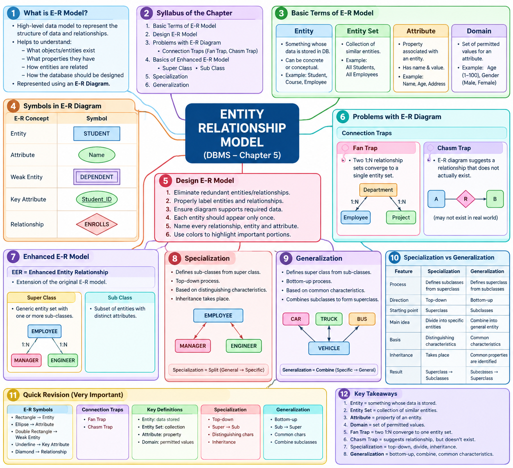

# LJ-DBMS-sem3-chapter5-explained

# DBMS — Chapter 5

# ENTITY RELATIONSHIP MODEL

I have extracted and reviewed the uploaded **DBMS Chapter 5 PPT**. The chapter contains **10 slides**, covering the syllabus from **Basic Terms of E-R Model** through **Specialization and Generalization**.

I will follow the PPT order exactly and will not introduce unrelated topics.

---

# STEP 1 — DEEP EXPLANATION

## 1. Entity Relationship Model

The **Entity Relationship (E-R) Model** is a high-level data model used to represent the structure of data and the relationships between different data items.

It helps us understand:

- What objects/entities exist in a system
    
- What properties those entities have
    
- How entities are related to each other
    
- How the database should be designed
    

The E-R model is generally represented using an **E-R Diagram**.

### Simple Example

Consider a college database.

We may have:

```text
Student
   |
   | has
   |
Course
```

Here:

- **Student** → Entity
    
- **Course** → Entity
    
- **has** → Relationship
    
- Student properties such as Student_ID, Name → Attributes
    

---

# 2. Syllabus of the Chapter

The PPT gives the following topics:

```text
ENTITY RELATIONSHIP MODEL
│
├── Basic Terms of E-R Model
│
├── Design E-R Model
│
├── Problems with E-R Diagram
│   ├── Connection Traps
│   ├── Fan Trap
│   └── Chasm Trap
│
├── Basics of Enhanced E-R Model
│   ├── Super Class
│   └── Sub Class
│
├── Specialization
│
└── Generalization
```

These topics will be covered in the subsequent question-bank sections as well.

---

# 3. Basic Terms of E-R Model

The PPT introduces four important basic terms:

1. Entity
    
2. Entity Set
    
3. Attribute
    
4. Domain
    

---

## 3.1 Entity

### Definition

> **An entity is something which is described in the database by storing its data.**

An entity may be:

- A **concrete entity**
    
- A **conceptual entity**
    

An entity represents something about which we want to store information in a database.

### Examples

In a college database:

```text
Student
Teacher
Course
Department
```

can be entities.

In a banking database:

```text
Customer
Account
Loan
Branch
```

can be entities.

### Real-world understanding

Suppose we have:

```text
Student:
Student_ID = 101
Name = Rahul
Age = 20
```

The particular student represented by this information is an **entity**.

### Exam Point ⭐

**Entity = Something whose data is stored/described in the database.**

---

# 3.2 Entity Set

### Definition

The PPT defines an **entity set** as:

> **A collection of similar entities.**

So, while an **entity** represents one particular object, an **entity set** represents a collection of similar entities.

### Example

Suppose we have:

```text
Student 1 → Rahul
Student 2 → Priya
Student 3 → Amit
Student 4 → Neha
```

Each individual student is an **entity**.

Together they form the:

```text
STUDENT ENTITY SET
│
├── Rahul
├── Priya
├── Amit
└── Neha
```

### Another Example

```text
Individual Entity     Entity Set
────────────────────────────────────
One student      →    All students
One employee     →    All employees
One customer     →    All customers
```

### Important Difference

|Entity|Entity Set|
|---|---|
|Represents an individual object|Collection of similar entities|
|Example: Rahul|Example: All Students|
|One particular entity|Group of entities|

### Exam Point ⭐

**Entity Set = Collection of similar entities.**

---

# 3.3 Attribute

### Definition

The PPT states:

> **An attribute describes a property associated with entities.**

An attribute gives information about an entity.

An attribute has:

- A **name**
    
- A **value** for each entity
    

### Example

Consider the entity:

```text
STUDENT
```

Its attributes could be:

```text
Student_ID
Name
Age
Address
Phone
```

For a particular student:

```text
Student_ID → 101
Name       → Rahul
Age        → 20
```

Here:

- `Student_ID` is an attribute
    
- `Name` is an attribute
    
- `Age` is an attribute
    

The actual values are:

- `101`
    
- `Rahul`
    
- `20`
    

### Simple Diagram

```text
             Name
              |
              |
Student_ID — STUDENT — Age
              |
              |
           Address
```

The attributes describe the properties of the entity.

### Example

```text
Entity: STUDENT

Attribute       Value
───────────────────────
Student_ID      101
Name            Rahul
Age             20
```

### Exam Point ⭐

**Attribute = Property/characteristic associated with an entity.**

---

# 3.4 Domain

### Definition

The PPT states:

> **A domain defines a set of permitted values for an attribute.**

In simple words, a **domain** tells us what values are allowed for an attribute.

### Example

Suppose:

```text
Attribute = Age
```

The domain might permit:

```text
1, 2, 3, ... , 100
```

If:

```text
Attribute = Gender
```

the permitted values might be:

```text
Male
Female
```

depending on the database design.

### Example

```text
Attribute: Student_Age

Domain:
1 to 100
```

Therefore:

```text
Student_Age = 20     ✓
Student_Age = 25     ✓
Student_Age = 200    ✗
```

The domain restricts the possible values.

### Important Relationship

```text
Entity
  ↓
Attribute
  ↓
Domain
  ↓
Permitted values
```

### Exam Point ⭐

**Domain = Set of permitted values for an attribute.**

---

# 4. Symbols in E-R Diagram

The PPT contains a section titled:

## Symbols in E-R Diagram

The PPT represents the basic E-R concepts using graphical symbols.

The listed concepts are:

- Entity
    
- Attribute
    
- Weak Entity
    
- Key Attribute
    
- Relationship
    

The standard representations shown/used in the PPT are based on the familiar E-R notation.

---

## 4.1 Entity Symbol

An **entity** is represented using a **rectangle**.

```text
┌───────────────┐
│    STUDENT    │
└───────────────┘
```

Example:

```text
┌───────────────┐
│    EMPLOYEE   │
└───────────────┘
```

### Remember ⭐

```text
Entity → Rectangle
```

---

# 4.2 Attribute Symbol

An **attribute** is represented using an **ellipse/oval**.

```text
       ___________
      /           \
     (    Name     )
      \___________/
```

Example:

```text
        Name
         ○
         |
         |
     STUDENT
```

More traditionally:

```text
       ( Name )
           |
           |
      [ STUDENT ]
```

### Remember ⭐

```text
Attribute → Ellipse/Oval
```

---

# 4.3 Weak Entity

A **weak entity** is a special type of entity that is represented differently from an ordinary strong entity in an E-R diagram.

The PPT specifically includes **Weak Entity** among the E-R diagram symbols.

The standard notation uses a **double rectangle**.

```text
╔═══════════════╗
║     DEPENDENT  ║
╚═══════════════╝
```

### Remember ⭐

```text
Weak Entity → Double Rectangle
```

---

# 4.4 Key Attribute

The PPT also lists **Key Attribute** as one of the E-R diagram symbols.

A key attribute is an attribute used to uniquely identify an entity.

### Example

For:

```text
STUDENT
```

we may have:

```text
Student_ID
Name
Age
```

If `Student_ID` uniquely identifies every student, it can act as the key attribute.

Conceptually:

```text
          (Student_ID)
                |
                |
          [ STUDENT ]
```

In standard E-R notation, the key attribute is shown with the attribute name **underlined**.

Example:

```text
        ( Student_ID )
          ──────────
```

### Remember ⭐

```text
Key Attribute → Underlined Attribute
```

---

# 4.5 Relationship

A **relationship** represents an association between entities.

The standard E-R symbol is a **diamond**.

```text
┌───────────┐       ◇        ┌───────────┐
│  STUDENT  │──────◇─────────│  COURSE   │
└───────────┘     ENROLLS    └───────────┘
```

Here:

- `STUDENT` → Entity
    
- `COURSE` → Entity
    
- `ENROLLS` → Relationship
    

### Remember ⭐

```text
Relationship → Diamond
```

---

# 5. Quick E-R Symbol Revision

|E-R Concept|Standard Symbol|
|---|---|
|Entity|Rectangle|
|Attribute|Ellipse/Oval|
|Weak Entity|Double Rectangle|
|Key Attribute|Underlined attribute|
|Relationship|Diamond|

### Very Important for Exam ⭐⭐⭐

Remember this:

```text
Rectangle       → Entity
Ellipse         → Attribute
Double Rectangle→ Weak Entity
Underlined      → Key Attribute
Diamond         → Relationship
```

This is a common diagram-based examination area.

---

# 6. Design E-R Model

The PPT next discusses:

## Design E-R Model

The PPT provides several best practices for developing an effective E-R diagram.

The main points are:

1. Eliminate redundant entities or relationships.
    
2. Properly label entities and relationships.
    
3. Ensure the E-R diagram supports all required data.
    
4. Each entity should appear only once.
    
5. Name every relationship, entity, and attribute.
    
6. Use colors to highlight important portions.
    

Let's understand each.

---

## 6.1 Eliminate Redundant Entities or Relationships

The PPT states:

> **Eliminate any redundant entities or relationships.**

### Meaning

Redundant means unnecessary or repeated.

An E-R diagram should not contain unnecessary entities or relationships.

### Example

Poor design:

```text
Student ─── Enrolls ─── Course
Student ─── Studies ─── Course
```

If both relationships represent exactly the same concept, one may be unnecessary.

The goal is to make the model clear and efficient.

### Exam Point ⭐

**Avoid unnecessary/redundant entities and relationships.**

---

# 6.2 Properly Label Entities and Relationships

The PPT says that all entities and relationships should be properly labelled.

For example:

```text
[ STUDENT ] ─── ◇ ENROLLS ◇ ─── [ COURSE ]
```

Instead of having unnamed objects:

```text
[ ? ] ─── ◇ ? ◇ ─── [ ? ]
```

Clear labels make the E-R diagram easier to understand.

---

# 6.3 E-R Diagram Must Support Required Data

The PPT states that there can be various valid approaches to an E-R diagram.

Therefore, there may not always be only one possible design.

However:

> The E-R diagram must support all the data that needs to be stored.

### Example

If a college database needs to store:

```text
Student
Course
Department
```

the E-R model should contain the necessary entities, attributes and relationships to represent that information.

### Important Point ⭐

**Different valid E-R designs may exist, but the chosen design must support all required data.**

---

# 6.4 Each Entity Should Appear Only Once

The PPT says:

> **You should assure that each entity only appears a single time in the E-R Diagram.**

### Example

Avoid unnecessarily drawing:

```text
[ STUDENT ]                    [ STUDENT ]
```

as two separate representations of the same entity in one E-R diagram.

Instead, use the entity once and connect its relationships appropriately.

### Exam Point ⭐

**An entity should appear only a single time in the E-R diagram.**

---

# 6.5 Name Every Relationship, Entity and Attribute

The PPT emphasizes naming:

- Relationships
    
- Entities
    
- Attributes
    

Example:

```text
             (Name)
                |
                |
[ STUDENT ] ◇ ENROLLS ◇ [ COURSE ]
```

Here everything is labelled:

- `STUDENT` → Entity
    
- `COURSE` → Entity
    
- `Name` → Attribute
    
- `ENROLLS` → Relationship
    

This improves clarity.

---

# 6.6 Use Colors to Highlight Important Portions

The PPT also recommends:

> **You should use colors to highlight important portions of the E-R Diagram.**

The purpose is to make important parts easier to identify.

### Important Note

The use of color is a **design recommendation** from the PPT, not a fundamental E-R notation rule.

---

# 7. Problems with E-R Diagram

The PPT next discusses:

# Problems with E-R Diagram

The E-R model can sometimes result in problems because of limitations in how entities are related in relational databases.

These problems are called:

## Connection Traps

The PPT identifies **two main types**:

1. Fan Trap
    
2. Chasm Trap
    

---

# 8. Connection Traps

### Definition

A **connection trap** is a problem that can occur in an E-R model because the relationships between entities may not represent the intended real-world connections correctly.

The PPT specifically identifies:

```text
Connection Traps
│
├── Fan Trap
│
└── Chasm Trap
```

---

# 9. Fan Trap

### Definition from PPT

> **Fan trap occurs when two relationship sets, having mapping cardinality one to many, converge to single entity set.**

This is an important definition to remember.

### Basic Structure

Conceptually:

```text
             Relationship 1
                  1 : N
                   \
                    \
                     [ ENTITY ]
                    /
                   /
             Relationship 2
                  1 : N
```

Two one-to-many relationships converge on one entity set.

### Simplified Representation

```text
[ A ] ─── 1 : N ───> [ C ]
                       ^
                       |
                    1 : N
                       |
[ B ] ────────────────┘
```

The structure can create ambiguity about the actual relationship between the entities.

### Example

Suppose:

```text
Department ─── employs ─── Employee
Department ─── controls ── Project
```

If the model structure does not clearly establish which employee works on which project, an incorrect inference may be possible.

### Exam Point ⭐⭐⭐

Remember the exact PPT definition:

**Fan Trap = Two 1:N relationship sets converge to a single entity set.**

---

# 10. Chasm Trap

### Definition from PPT

> **Chasm trap occurs when an E-R Diagram suggests the existence of a relationship between entity sets, but in real it doesn’t exist.**

In simple words:

The E-R diagram may make it appear that two entities are related, but in reality there is no such relationship.

### Conceptual Representation

```text
[ Entity A ]
      |
      |
 [ Relationship ]
      |
      |
[ Entity B ]
```

The diagram may suggest a connection, even though the real-world data does not establish the expected relationship.

### Meaning

```text
E-R Diagram
     ↓
Suggests relationship
     ↓
But actual relationship
does NOT exist
     ↓
Chasm Trap
```

### Exam Point ⭐⭐⭐

**Chasm Trap = E-R diagram suggests a relationship that does not actually exist.**

---

# 11. Fan Trap vs Chasm Trap

|Feature|Fan Trap|Chasm Trap|
|---|---|---|
|Type|Connection trap|Connection trap|
|PPT definition|Two 1:N relationship sets converge to one entity set|Diagram suggests a relationship that does not actually exist|
|Main issue|Converging relationships can create ambiguity|Apparent relationship does not really exist|
|Important clue|**1:N + 1:N convergence**|**Suggested but nonexistent relationship**|

### Easy Memory Trick

```text
FAN → relationships spread/converge like a fan

CHASM → apparent connection has a gap
```

---

# 12. Basics of Enhanced E-R Model

The PPT next introduces:

# Enhanced Entity Relationship Model

EER stands for:

**Enhanced Entity Relationship**

### Definition

The PPT states:

> **Enhanced Entity Relationship (EER) is a high-level data model that incorporates the extensions to the original ER model.**

Therefore:

```text
EER Model
   =
Enhanced version of
Original ER Model
```

It extends the original E-R model with additional concepts.

---

# 13. Super Class

### Definition from PPT

> **A super-class is a generic entity set, which has relationship with one or more sub-classes.**

A superclass represents a more general category.

### Example

Suppose:

```text
          EMPLOYEE
```

is a general entity set.

It may have subclasses:

```text
             EMPLOYEE
              /     \
             /       \
        MANAGER     ENGINEER
```

Here:

```text
EMPLOYEE → Super Class
MANAGER  → Sub Class
ENGINEER → Sub Class
```

### Important Point ⭐

A superclass is **generic** and can have one or more subclasses.

---

# 14. Sub Class

### Definition from PPT

> **A Sub Class is a subset of entities in an entity set, which has attributes distinct from those in other subsets.**

A subclass is therefore a more specific group within a superclass.

### Example

Consider:

```text
              EMPLOYEE
             /        \
            /          \
       MANAGER        ENGINEER
```

`MANAGER` and `ENGINEER` are subsets of `EMPLOYEE`.

They can have characteristics that distinguish them.

### Conceptual Structure

```text
             SUPER CLASS
             EMPLOYEE
                 │
       ┌─────────┴─────────┐
       │                   │
       ▼                   ▼
   SUB CLASS           SUB CLASS
   MANAGER             ENGINEER
```

---

# 15. Specialization

The next major topic is:

# Specialization

### Definition

The PPT defines specialization as:

> **Specialization is the process of defining Sub-classes of a Super Class based on some distinguishing characteristics.**

In simple words:

We start with a **general superclass** and divide it into more specific subclasses according to distinguishing characteristics.

---

## 15.1 Specialization is Top-Down

The PPT specifically states:

> **Specialization is a top-down process to define Super Class/Sub class relationship.**

This is extremely important for exams.

### Direction

```text
          SUPER CLASS
              │
              ↓
        Divide into
              │
      ┌───────┴───────┐
      ↓               ↓
  SUB CLASS       SUB CLASS
```

Therefore:

```text
Specialization
       ↓
   Top → Down
```

---

# 15.2 Entity Gets Divided into Sub-Entities

The PPT also explains that in specialization:

> A particular entity gets divided into sub-entities on the basis of its characteristics.

For example:

```text
             EMPLOYEE
                │
          Specialization
                ↓
       ┌────────┴────────┐
       ↓                 ↓
    MANAGER           ENGINEER
```

The general entity category is divided according to characteristics.

---

# 15.3 Inheritance in Specialization

The PPT explicitly states:

> **Also in Specialization inheritance takes place.**

This means subclasses inherit relevant properties/attributes from their superclass.

Conceptually:

```text
              EMPLOYEE
           Name, ID, Salary
                  │
        ┌─────────┴─────────┐
        ↓                   ↓
     MANAGER             ENGINEER
        │                   │
   inherited data      inherited data
```

### Exam Point ⭐⭐⭐

Three things to remember about specialization:

```text
Specialization
│
├── Defines Subclasses
├── Based on distinguishing characteristics
├── Top-down process
└── Inheritance takes place
```

---

# 16. Generalization

The next major topic is:

# Generalization

### Definition

The PPT defines generalization as:

> **Generalization is the process of defining a Super Class from Sub Classes based on some common characteristics.**

So, unlike specialization, generalization starts with specific subclasses and creates a more general superclass.

---

# 17. Generalization is Bottom-Up

The PPT states:

> **Generalization is a bottom-up process to define Super Class / Sub Class relationship.**

Therefore:

```text
SUB CLASS       SUB CLASS
    \              /
     \            /
      \          /
       ↓        ↓
        SUPER CLASS
```

### Direction

```text
Generalization
       ↓
Bottom → Up
```

This is one of the most important differences between specialization and generalization.

---

# 18. Common Characteristics in Generalization

The PPT says:

> **It minimizes the differences between entities of different entity sets by identifying common characteristics.**

In other words, we look for common properties among different entity sets.

### Example

Suppose:

```text
CAR
TRUCK
BUS
```

all have common characteristics such as:

```text
Vehicle_ID
Color
Model
```

These common characteristics can help create a generalized entity:

```text
             VEHICLE
          /     |      \
         /      |       \
       CAR    TRUCK      BUS
```

The common characteristics are represented at the generalized level.

---

# 19. Properties are Drawn from Particular Entities

The PPT states:

> **In the Generalization process properties are drawn from particular entities and thus we can create generalized entity.**

So the process is:

```text
Specific Entities
       ↓
Identify common properties
       ↓
Combine common properties
       ↓
Create generalized entity
```

### Example

```text
      CAR                TRUCK
       │                  │
       │                  │
       └──── Common ──────┘
               │
               ↓
            VEHICLE
```

---

# 20. Generalization Combines Subclasses to Form Superclass

The PPT provides a summary:

> **Generalization process combines subclasses to form superclass.**

This is an extremely important one-line exam answer.

```text
Subclass 1 ───┐
              │
Subclass 2 ───┼──→ Superclass
              │
Subclass 3 ───┘
```

### Example

```text
      CAR
       \
        \
       TRUCK ───→ VEHICLE
        /
       /
      BUS
```

Here:

```text
CAR
TRUCK
BUS
```

are subclasses, while:

```text
VEHICLE
```

is the superclass.

---

# 21. Specialization vs Generalization

This is one of the **most important comparisons in the chapter**.

|Feature|Specialization|Generalization|
|---|---|---|
|Process|Defines subclasses from superclass|Defines superclass from subclasses|
|Direction|Top-down|Bottom-up|
|Starting point|Superclass|Subclasses|
|Main idea|Divide a general entity into specific entities|Combine specific entities into a general entity|
|Basis|Distinguishing characteristics|Common characteristics|
|PPT point|Inheritance takes place|Common properties are identified|
|Easy representation|Superclass → Subclasses|Subclasses → Superclass|

### Memory Trick ⭐⭐⭐

```text
SPECIALIZATION
     ↓
Specific
     ↓
TOP → DOWN

GENERALIZATION
     ↑
General
     ↑
BOTTOM → UP
```

Or simply:

```text
Specialization = Split
Generalization = Combine
```

---

# 22. Complete Chapter Concept Flow

The whole chapter can be understood as:

```text
                 ENTITY RELATIONSHIP MODEL
                          │
          ┌───────────────┴────────────────┐
          │                                │
     Basic Terms                       E-R Design
          │                                │
   ┌──────┼──────┬──────┐           ┌──────┴──────┐
   │      │      │      │           │             │
Entity  Entity  Attribute Domain   Rules       Best Practices
        Set
          │
          ↓
    E-R Diagram Symbols
          │
    ┌─────┼────────┬────────┐
    │     │        │        │
 Entity Attribute Weak     Key
                   Entity  Attribute
                     │
                     └── Relationship
                              │
                              ↓
                     Problems / Traps
                              │
                    ┌─────────┴─────────┐
                    │                   │
                Fan Trap            Chasm Trap
                    │                   │
                    └─────────┬─────────┘
                              ↓
                         EER Model
                              │
                     ┌────────┴────────┐
                     │                 │
                 Super Class        Sub Class
                     │                 │
                     └────────┬────────┘
                              ↓
                   Specialization /
                   Generalization
                       │          │
                       ↓          ↓
                  Top → Down   Bottom → Up
                       │          │
                     Split      Combine
```

---

# Chapter Summary

The PPT chapter **Entity Relationship Model** covers the fundamentals of E-R and Enhanced E-R modeling.

### Main concepts:

1. **Entity** — Something whose data is stored/described in the database.
    
2. **Entity Set** — Collection of similar entities.
    
3. **Attribute** — Property associated with an entity.
    
4. **Domain** — Set of permitted values for an attribute.
    
5. **E-R Symbols** — Used to graphically represent entities, attributes, relationships, etc.
    
6. **E-R Design** — Should avoid redundancy, use proper labels, support required data, and maintain clear representation.
    
7. **Connection Traps** — Problems that can occur in E-R modeling.
    
8. **Fan Trap** — Two 1:N relationship sets converge to a single entity set.
    
9. **Chasm Trap** — Diagram suggests a relationship that does not actually exist.
    
10. **EER Model** — Enhanced version of the original E-R model.
    
11. **Super Class** — Generic entity set related to subclasses.
    
12. **Sub Class** — Subset of entities with distinguishing attributes.
    
13. **Specialization** — Top-down process of defining subclasses from a superclass.
    
14. **Generalization** — Bottom-up process of defining a superclass from subclasses.
    

---

# Important Definitions

### 1. Entity

An entity is something which is described in the database by storing its data.

### 2. Entity Set

An entity set is a collection of similar entities.

### 3. Attribute

An attribute describes a property associated with entities.

### 4. Domain

A domain defines a set of permitted values for an attribute.

### 5. Connection Trap

A problem that can occur due to limitations in the way entities are related in relational databases.

### 6. Fan Trap

A fan trap occurs when two relationship sets having mapping cardinality 1:N converge to a single entity set.

### 7. Chasm Trap

A chasm trap occurs when an E-R diagram suggests the existence of a relationship between entity sets, but in reality it does not exist.

### 8. Enhanced Entity Relationship

EER is a high-level data model that incorporates extensions to the original ER model.

### 9. Super Class

A superclass is a generic entity set that has a relationship with one or more subclasses.

### 10. Sub Class

A subclass is a subset of entities in an entity set having attributes distinct from those in other subsets.

### 11. Specialization

Specialization is the process of defining subclasses of a superclass based on distinguishing characteristics.

### 12. Generalization

Generalization is the process of defining a superclass from subclasses based on common characteristics.

---

# Important Differences

## Entity vs Entity Set

|Entity|Entity Set|
|---|---|
|Individual object|Collection of similar objects|
|Example: One student|Example: All students|

## Specialization vs Generalization

|Specialization|Generalization|
|---|---|
|Top-down|Bottom-up|
|Superclass → Subclasses|Subclasses → Superclass|
|Divides|Combines|
|Based on distinguishing characteristics|Based on common characteristics|
|Inheritance takes place|Common properties are identified|

## Fan Trap vs Chasm Trap

|Fan Trap|Chasm Trap|
|---|---|
|Two 1:N relationships converge to one entity set|Diagram suggests a relationship that does not actually exist|
|Focus is on relationship convergence|Focus is on nonexistent/apparent relationship|

---

# Important Exam Points ⭐⭐⭐

Memorize these especially:

```text
Entity
→ Something described by storing its data.

Entity Set
→ Collection of similar entities.

Attribute
→ Property associated with an entity.

Domain
→ Set of permitted values for an attribute.
```

```text
Entity          → Rectangle
Attribute       → Ellipse
Weak Entity     → Double Rectangle
Key Attribute   → Underlined Attribute
Relationship    → Diamond
```

```text
Connection Traps
├── Fan Trap
└── Chasm Trap
```

```text
Fan Trap
→ Two 1:N relationship sets converge to a single entity set.
```

```text
Chasm Trap
→ E-R diagram suggests a relationship that does not actually exist.
```

```text
EER
→ Enhanced Entity Relationship
```

```text
Specialization
→ Top-down
→ Superclass → Subclasses
→ Distinguishing characteristics
→ Inheritance
```

```text
Generalization
→ Bottom-up
→ Subclasses → Superclass
→ Common characteristics
→ Combines subclasses to form superclass
```

---

## PPT Coverage for STEP 1

|PPT Topic|Covered|
|---|--:|
|Chapter: Entity Relationship Model|✅|
|Basic Terms of E-R Model|✅|
|Entity|✅|
|Entity Set|✅|
|Attribute|✅|
|Domain|✅|
|Symbols in E-R Diagram|✅|
|Entity Symbol|✅|
|Attribute Symbol|✅|
|Weak Entity|✅|
|Key Attribute|✅|
|Relationship|✅|
|Design E-R Model|✅|
|Redundant entities/relationships|✅|
|Proper labeling|✅|
|Supporting required data|✅|
|Single occurrence of entity|✅|
|Naming entities/relationships/attributes|✅|
|Use of colors|✅|
|Problems with E-R Diagram|✅|
|Connection Traps|✅|
|Fan Trap|✅|
|Chasm Trap|✅|
|Basics of EER Model|✅|
|Enhanced Entity Relationship|✅|
|Super Class|✅|
|Sub Class|✅|
|Specialization|✅|
|Top-down process|✅|
|Distinguishing characteristics|✅|
|Inheritance|✅|
|Generalization|✅|
|Bottom-up process|✅|
|Common characteristics|✅|
|Combining subclasses into superclass|✅|

**STEP 1 — Deep Explanation: COMPLETED ✅**

When you say **“next”**, I will continue directly with **STEP 2 — Complete Mind Map**, without restarting the chapter.

---
<p align="center">
  
</p>


---

Yes 👍 You want the **text-based mind map on the LEFT side**, like your previous chapters—not the infographic-style version.

Here is the **complete text mind map**, kept in PPT order:

# STEP 2 — COMPLETE TEXT MIND MAP

```text
ENTITY RELATIONSHIP MODEL
│
├── 1. Basic Terms of E-R Model
│   │
│   ├── Entity
│   │   ├── Something described in database
│   │   ├── Data is stored about it
│   │   ├── Concrete entity
│   │   └── Conceptual entity
│   │
│   ├── Entity Set
│   │   ├── Collection of similar entities
│   │   └── Example: All Students
│   │
│   ├── Attribute
│   │   ├── Property associated with entity
│   │   ├── Has a name
│   │   └── Has a value
│   │
│   └── Domain
│       ├── Set of permitted values
│       └── Defines allowed values for attribute
│
├── 2. Symbols in E-R Diagram
│   │
│   ├── Entity
│   │   └── Rectangle
│   │
│   ├── Attribute
│   │   └── Ellipse / Oval
│   │
│   ├── Weak Entity
│   │   └── Double Rectangle
│   │
│   ├── Key Attribute
│   │   └── Underlined Attribute
│   │
│   └── Relationship
│       └── Diamond
│
├── 3. Design E-R Model
│   │
│   ├── Eliminate redundant entities
│   │
│   ├── Eliminate redundant relationships
│   │
│   ├── Properly label entities
│   │
│   ├── Properly label relationships
│   │
│   ├── Ensure diagram supports required data
│   │
│   ├── Each entity should appear only once
│   │
│   ├── Name every relationship
│   │
│   ├── Name every entity
│   │
│   ├── Name every attribute
│   │
│   └── Use colors to highlight important portions
│
├── 4. Problems with E-R Diagram
│   │
│   └── Connection Traps
│       │
│       ├── Fan Trap
│       │   ├── Two relationship sets
│       │   ├── Mapping cardinality = 1:N
│       │   └── Converge to a single entity set
│       │
│       └── Chasm Trap
│           ├── E-R diagram suggests a relationship
│           └── Relationship does not actually exist
│
├── 5. Enhanced E-R Model
│   │
│   ├── EER
│   │   └── Enhanced Entity Relationship
│   │
│   ├── Extension of original E-R Model
│   │
│   ├── Super Class
│   │   ├── Generic entity set
│   │   └── Has relationship with one or more subclasses
│   │
│   └── Sub Class
│       ├── Subset of entities in entity set
│       └── Has distinguishing attributes
│
├── 6. Specialization
│   │
│   ├── Defines subclasses from superclass
│   │
│   ├── Based on distinguishing characteristics
│   │
│   ├── Top-down process
│   │
│   ├── Super Class
│   │       ↓
│   │   Sub Classes
│   │
│   └── Inheritance takes place
│
├── 7. Generalization
│   │
│   ├── Defines superclass from subclasses
│   │
│   ├── Based on common characteristics
│   │
│   ├── Bottom-up process
│   │
│   ├── Sub Classes
│   │       ↓
│   │   Super Class
│   │
│   ├── Identifies common characteristics
│   │
│   └── Combines subclasses to form superclass
│
└── 8. Important Comparisons
    │
    ├── Entity vs Entity Set
    │   ├── Entity → Individual
    │   └── Entity Set → Collection
    │
    ├── Fan Trap vs Chasm Trap
    │   ├── Fan Trap → 1:N relationships converge
    │   └── Chasm Trap → Suggested relationship doesn't exist
    │
    └── Specialization vs Generalization
        ├── Specialization
        │   ├── Top-down
        │   ├── Super → Sub
        │   ├── Specific subclasses
        │   └── Distinguishing characteristics
        │
        └── Generalization
            ├── Bottom-up
            ├── Sub → Super
            ├── General entity
            └── Common characteristics
```

## ⭐ One-Line Revision Map

```text
E-R MODEL
│
├── Basic Terms
│   ├── Entity
│   ├── Entity Set
│   ├── Attribute
│   └── Domain
│
├── E-R Symbols
│   ├── Rectangle → Entity
│   ├── Ellipse → Attribute
│   ├── Double Rectangle → Weak Entity
│   ├── Underline → Key Attribute
│   └── Diamond → Relationship
│
├── E-R Design
│   ├── Remove Redundancy
│   ├── Proper Labels
│   ├── Required Data
│   ├── Entity Once
│   └── Highlight Important Parts
│
├── Connection Traps
│   ├── Fan Trap
│   └── Chasm Trap
│
├── EER Model
│   ├── Super Class
│   └── Sub Class
│
├── Specialization
│   ├── Top → Down
│   ├── Super → Sub
│   ├── Distinguishing Characteristics
│   └── Inheritance
│
└── Generalization
    ├── Bottom → Up
    ├── Sub → Super
    ├── Common Characteristics
    └── Combine Subclasses
```

**STEP 2 — Complete Text Mind Map: DONE ✅**

**STEP 3 — Mind Map Image: DONE ✅**

When you say **“next”**, I will start **STEP 4 — MCQs FIRST**, with answers immediately after every question and continue until the complete PPT is covered.

---

# STEP 4 — MCQs FIRST

# DBMS Chapter 5 — Entity Relationship Model

I’ll cover the PPT topic-by-topic and give the answer immediately after every MCQ.

---

## A. Basic Terms of E-R Model

### Q1. What does the E-R Model represent?

A) Program execution  
B) Data and relationships between data  
C) Operating system processes  
D) Network topology

**Answer: B) Data and relationships between data**

---

### Q2. What does E-R stand for?

A) Entity-Record  
B) Entity-Relationship  
C) Entry-Relationship  
D) Entity-Reference

**Answer: B) Entity-Relationship**

---

### Q3. An entity is:

A) A collection of attributes only  
B) Something described in the database by storing its data  
C) A set of permitted values  
D) A relationship between tables

**Answer: B) Something described in the database by storing its data**

---

### Q4. Which of the following can be an entity?

A) Student  
B) Course  
C) Employee  
D) All of the above

**Answer: D) All of the above**

---

### Q5. An entity set is:

A) A single attribute  
B) A collection of similar entities  
C) A set of relationships  
D) A set of database commands

**Answer: B) A collection of similar entities**

---

### Q6. Which represents an entity set?

A) One particular student  
B) All students  
C) One student's name  
D) One student's age

**Answer: B) All students**

---

### Q7. Which statement correctly distinguishes an entity from an entity set?

A) Entity is a collection; entity set is an individual  
B) Entity is an individual; entity set is a collection of similar entities  
C) Both mean exactly the same thing  
D) Entity set is an attribute

**Answer: B) Entity is an individual; entity set is a collection of similar entities**

---

### Q8. An attribute describes:

A) A property associated with an entity  
B) A collection of entities  
C) A relationship only  
D) A database program

**Answer: A) A property associated with an entity**

---

### Q9. Which of the following can be an attribute of Student?

A) Name  
B) Age  
C) Address  
D) All of the above

**Answer: D) All of the above**

---

### Q10. An attribute generally has:

A) Only a relationship  
B) A name and a value  
C) Only a domain  
D) Only an entity

**Answer: B) A name and a value**

---

### Q11. What is a domain?

A) Collection of entities  
B) Set of permitted values for an attribute  
C) Collection of relationships  
D) Name of an entity

**Answer: B) Set of permitted values for an attribute**

---

### Q12. The domain of an attribute specifies:

A) The entities related to it  
B) The permitted values of that attribute  
C) The number of relationships  
D) The name of the database

**Answer: B) The permitted values of that attribute**

---

### Q13. If Age has a domain of 1–100, which value is outside the domain?

A) 20  
B) 45  
C) 80  
D) 150

**Answer: D) 150**

---

### Q14. Which sequence is correct?

A) Entity → Attribute → Domain  
B) Domain → Entity → Attribute  
C) Attribute → Entity → Relationship  
D) Relationship → Domain → Entity

**Answer: A) Entity → Attribute → Domain**

---

## B. E-R Diagram Symbols

### Q15. Which symbol represents an entity in an E-R diagram?

A) Rectangle  
B) Ellipse  
C) Diamond  
D) Triangle

**Answer: A) Rectangle**

---

### Q16. Which symbol represents an attribute?

A) Rectangle  
B) Diamond  
C) Ellipse  
D) Double rectangle

**Answer: C) Ellipse**

---

### Q17. Which symbol represents a relationship?

A) Rectangle  
B) Diamond  
C) Ellipse  
D) Circle

**Answer: B) Diamond**

---

### Q18. A weak entity is represented using:

A) Single ellipse  
B) Single rectangle  
C) Double rectangle  
D) Diamond

**Answer: C) Double rectangle**

---

### Q19. A key attribute is represented by:

A) A double rectangle  
B) An underlined attribute  
C) A diamond  
D) A double diamond

**Answer: B) An underlined attribute**

---

### Q20. Which pairing is correct?

A) Entity → Diamond  
B) Attribute → Rectangle  
C) Relationship → Diamond  
D) Weak Entity → Ellipse

**Answer: C) Relationship → Diamond**

---

### Q21. Which pairing is INCORRECT?

A) Entity → Rectangle  
B) Attribute → Ellipse  
C) Relationship → Diamond  
D) Weak Entity → Single Ellipse

**Answer: D) Weak Entity → Single Ellipse**

---

### Q22. In an E-R diagram, `STUDENT` represented by a rectangle indicates:

A) Attribute  
B) Entity  
C) Domain  
D) Relationship

**Answer: B) Entity**

---

### Q23. In an E-R diagram, `Name` represented by an ellipse indicates:

A) Entity  
B) Attribute  
C) Relationship  
D) Entity set

**Answer: B) Attribute**

---

### Q24. If `Student_ID` is underlined in an E-R diagram, it represents:

A) Relationship  
B) Domain  
C) Key attribute  
D) Weak entity

**Answer: C) Key attribute**

---

### Q25. Which symbol represents a weak entity?

A) ◇  
B) ○  
C) ▭  
D) Double rectangle

**Answer: D) Double rectangle**

---

## C. Design E-R Model

### Q26. What should be eliminated while designing an E-R model?

A) Required entities  
B) Required attributes  
C) Redundant entities or relationships  
D) Important relationships

**Answer: C) Redundant entities or relationships**

---

### Q27. Entities and relationships in an E-R diagram should be:

A) Properly labelled  
B) Left unnamed  
C) Randomly named  
D) Repeated

**Answer: A) Properly labelled**

---

### Q28. An E-R diagram should support:

A) Only one type of data  
B) All required data  
C) Only entity names  
D) Only attributes

**Answer: B) All required data**

---

### Q29. According to the PPT, each entity should appear:

A) At least three times  
B) At least twice  
C) Only once  
D) As many times as possible

**Answer: C) Only once**

---

### Q30. Which of the following should be named in an E-R diagram?

A) Relationships  
B) Entities  
C) Attributes  
D) All of the above

**Answer: D) All of the above**

---

### Q31. What can be used to highlight important portions of an E-R diagram?

A) Colors  
B) Programming code  
C) SQL commands  
D) Passwords

**Answer: A) Colors**

---

### Q32. Which is a good E-R design practice?

A) Add redundant relationships  
B) Leave relationships unnamed  
C) Eliminate redundant entities  
D) Repeat every entity several times

**Answer: C) Eliminate redundant entities**

---

### Q33. Which statement is correct about valid E-R diagram designs?

A) There can never be more than one valid design  
B) Various valid approaches can exist  
C) Only one attribute can be used  
D) Relationships are unnecessary

**Answer: B) Various valid approaches can exist**

---

## D. Problems with E-R Diagram

### Q34. What type of problem is Fan Trap?

A) Programming error  
B) Connection Trap  
C) Syntax error  
D) Attribute error

**Answer: B) Connection Trap**

---

### Q35. Which are the two connection traps mentioned in the PPT?

A) Fan Trap and Chasm Trap  
B) Entity Trap and Attribute Trap  
C) Domain Trap and Key Trap  
D) Table Trap and Column Trap

**Answer: A) Fan Trap and Chasm Trap**

---

## E. Fan Trap

### Q36. A Fan Trap occurs when:

A) One relationship connects two attributes  
B) Two 1:N relationship sets converge to a single entity set  
C) No entities exist  
D) An attribute has no domain

**Answer: B) Two 1:N relationship sets converge to a single entity set**

---

### Q37. What mapping cardinality is specifically associated with a Fan Trap in the PPT?

A) 1:1  
B) 1:N  
C) M:1 only  
D) M:N only

**Answer: B) 1:N**

---

### Q38. A Fan Trap involves how many relationship sets?

A) One  
B) Two  
C) Three  
D) Four

**Answer: B) Two**

---

### Q39. In a Fan Trap, the relationship sets:

A) Disappear  
B) Converge to a single entity set  
C) Become attributes  
D) Become domains

**Answer: B) Converge to a single entity set**

---

### Q40. Which is the correct description of a Fan Trap?

A) A relationship that does not exist  
B) Two 1:N relationships converging on one entity set  
C) An entity without attributes  
D) A domain without values

**Answer: B) Two 1:N relationships converging on one entity set**

---

## F. Chasm Trap

### Q41. A Chasm Trap occurs when:

A) An E-R diagram suggests a relationship that does not actually exist  
B) Two 1:N relationships converge  
C) An attribute has multiple values  
D) An entity has no name

**Answer: A) An E-R diagram suggests a relationship that does not actually exist**

---

### Q42. What is the main issue in a Chasm Trap?

A) Redundant attribute  
B) Suggested but nonexistent relationship  
C) Missing domain  
D) Duplicate entity

**Answer: B) Suggested but nonexistent relationship**

---

### Q43. Which of the following is a Connection Trap?

A) Fan Trap  
B) Chasm Trap  
C) Both A and B  
D) Neither A nor B

**Answer: C) Both A and B**

---

### Q44. Which statement is TRUE?

A) Fan Trap and Chasm Trap are E-R connection traps  
B) Fan Trap is an attribute  
C) Chasm Trap is an entity  
D) Neither is related to E-R diagrams

**Answer: A) Fan Trap and Chasm Trap are E-R connection traps**

---

## G. Enhanced E-R Model

### Q45. EER stands for:

A) Extended Entity Record  
B) Enhanced Entity Relationship  
C) Entity Enhanced Record  
D) External Entity Relationship

**Answer: B) Enhanced Entity Relationship**

---

### Q46. EER is:

A) A replacement for databases  
B) An extension of the original E-R model  
C) A programming language  
D) A type of operating system

**Answer: B) An extension of the original E-R model**

---

### Q47. The Enhanced E-R Model is a:

A) High-level data model  
B) Low-level programming language  
C) File system  
D) Network protocol

**Answer: A) High-level data model**

---

### Q48. Which concepts are introduced in the PPT under the Enhanced E-R Model?

A) Super Class and Sub Class  
B) Tables and Views  
C) Files and Processes  
D) Loops and Functions

**Answer: A) Super Class and Sub Class**

---

## H. Super Class and Sub Class

### Q49. A superclass is:

A) A specific attribute  
B) A generic entity set  
C) A relationship  
D) A domain

**Answer: B) A generic entity set**

---

### Q50. A superclass can have relationships with:

A) Only attributes  
B) One or more subclasses  
C) Only domains  
D) No subclasses

**Answer: B) One or more subclasses**

---

### Q51. Which is an example of a superclass?

A) Employee  
B) Name  
C) Age  
D) Salary

**Answer: A) Employee**

---

### Q52. A subclass is:

A) A subset of entities in an entity set  
B) A domain  
C) A relationship symbol  
D) A database command

**Answer: A) A subset of entities in an entity set**

---

### Q53. A subclass has attributes:

A) Completely unrelated to its superclass  
B) Distinct from those in other subsets  
C) Only representing domains  
D) That cannot distinguish entities

**Answer: B) Distinct from those in other subsets**

---

### Q54. Consider:

```text
        EMPLOYEE
        /       \
   MANAGER    ENGINEER
```

`EMPLOYEE` is the:

A) Attribute  
B) Subclass  
C) Superclass  
D) Domain

**Answer: C) Superclass**

---

### Q55. In the same diagram, `MANAGER` is a:

A) Superclass  
B) Subclass  
C) Domain  
D) Relationship

**Answer: B) Subclass**

---

## I. Specialization

### Q56. Specialization is the process of defining:

A) Superclasses from subclasses  
B) Subclasses from a superclass  
C) Domains from attributes  
D) Relationships from domains

**Answer: B) Subclasses from a superclass**

---

### Q57. Specialization is based on:

A) Common characteristics only  
B) Distinguishing characteristics  
C) Database size  
D) Number of attributes

**Answer: B) Distinguishing characteristics**

---

### Q58. Specialization is a:

A) Bottom-up process  
B) Top-down process  
C) Circular process  
D) Random process

**Answer: B) Top-down process**

---

### Q59. In specialization, the direction is:

A) Subclass → Superclass  
B) Superclass → Subclasses  
C) Attribute → Entity  
D) Domain → Entity

**Answer: B) Superclass → Subclasses**

---

### Q60. Which statement about specialization is correct?

A) It combines subclasses into a superclass  
B) It defines subclasses based on distinguishing characteristics  
C) It removes all attributes  
D) It creates only domains

**Answer: B) It defines subclasses based on distinguishing characteristics**

---

### Q61. In specialization, inheritance:

A) Does not take place  
B) Takes place  
C) Is prohibited  
D) Is unrelated

**Answer: B) Takes place**

---

### Q62. Which diagram best represents specialization?

A)

```text
CAR ───┐
TRUCK ─┼──→ VEHICLE
BUS ───┘
```

B)

```text
        EMPLOYEE
        /       \
   MANAGER    ENGINEER
```

C)

```text
Attribute → Domain
```

D)

```text
Entity → Attribute
```

**Answer: B)**

```text
        EMPLOYEE
        /       \
   MANAGER    ENGINEER
```

---

## J. Generalization

### Q63. Generalization is the process of defining:

A) Subclasses from superclass  
B) Superclass from subclasses  
C) Attributes from domains  
D) Relationships from entities

**Answer: B) Superclass from subclasses**

---

### Q64. Generalization is based on:

A) Distinguishing characteristics  
B) Common characteristics  
C) Random characteristics  
D) No characteristics

**Answer: B) Common characteristics**

---

### Q65. Generalization is a:

A) Top-down process  
B) Bottom-up process  
C) Left-to-right process  
D) Circular process

**Answer: B) Bottom-up process**

---

### Q66. In generalization, the direction is:

A) Superclass → subclasses  
B) Subclasses → superclass  
C) Attribute → domain  
D) Entity → relationship

**Answer: B) Subclasses → superclass**

---

### Q67. Generalization helps to:

A) Identify common characteristics  
B) Remove all entities  
C) Eliminate all relationships  
D) Remove domains

**Answer: A) Identify common characteristics**

---

### Q68. Generalization combines:

A) Attributes to form domains  
B) Subclasses to form a superclass  
C) Domains to form entities  
D) Relationships to form attributes

**Answer: B) Subclasses to form a superclass**

---

### Q69. Which diagram best represents generalization?

A)

```text
        EMPLOYEE
        /       \
   MANAGER    ENGINEER
```

B)

```text
CAR      TRUCK      BUS
 \         |         /
  \        |        /
      VEHICLE
```

C)

```text
Entity → Attribute
```

D)

```text
Domain → Attribute
```

**Answer: B)**

```text
CAR      TRUCK      BUS
 \         |         /
  \        |        /
      VEHICLE
```

---

### Q70. In generalization, properties are drawn from:

A) Particular entities to create a generalized entity  
B) Domains to create attributes  
C) Relationships to create entities  
D) Attributes to create relationships

**Answer: A) Particular entities to create a generalized entity**

---

## K. Specialization vs Generalization

### Q71. Which process is top-down?

A) Generalization  
B) Specialization  
C) Chasm Trap  
D) Fan Trap

**Answer: B) Specialization**

---

### Q72. Which process is bottom-up?

A) Specialization  
B) Generalization  
C) Entity creation  
D) Attribute creation

**Answer: B) Generalization**

---

### Q73. Which process starts with a superclass?

A) Generalization  
B) Specialization  
C) Chasm Trap  
D) Fan Trap

**Answer: B) Specialization**

---

### Q74. Which process starts with subclasses?

A) Specialization  
B) Generalization  
C) Entity Set  
D) Domain

**Answer: B) Generalization**

---

### Q75. Specialization is mainly based on:

A) Common characteristics  
B) Distinguishing characteristics  
C) Domain values  
D) Relationship cardinality

**Answer: B) Distinguishing characteristics**

---

### Q76. Generalization is mainly based on:

A) Distinguishing characteristics  
B) Common characteristics  
C) Key attributes  
D) Weak entities

**Answer: B) Common characteristics**

---

### Q77. Which process divides a general entity into more specific entities?

A) Generalization  
B) Specialization  
C) Chasm Trap  
D) Connection Trap

**Answer: B) Specialization**

---

### Q78. Which process combines specific entities into a generalized entity?

A) Specialization  
B) Generalization  
C) Fan Trap  
D) Domain creation

**Answer: B) Generalization**

---

### Q79. Which statement is correct?

A) Specialization = Bottom-up  
B) Generalization = Top-down  
C) Specialization = Top-down and Generalization = Bottom-up  
D) Both are only top-down

**Answer: C) Specialization = Top-down and Generalization = Bottom-up**

---

### Q80. Which pair is correctly matched?

A) Specialization → Common characteristics  
B) Generalization → Distinguishing characteristics  
C) Specialization → Distinguishing characteristics  
D) Generalization → 1:N convergence

**Answer: C) Specialization → Distinguishing characteristics**

---

# L. Mixed Exam-Oriented MCQs

### Q81. Which of the following is NOT one of the basic terms listed in the PPT?

A) Entity  
B) Entity Set  
C) Attribute  
D) Compiler

**Answer: D) Compiler**

---

### Q82. Which concept defines permitted values of an attribute?

A) Entity  
B) Domain  
C) Relationship  
D) Superclass

**Answer: B) Domain**

---

### Q83. Which concept represents a property of an entity?

A) Attribute  
B) Domain  
C) Entity Set  
D) Connection Trap

**Answer: A) Attribute**

---

### Q84. Which of the following represents a collection of similar entities?

A) Entity  
B) Entity Set  
C) Attribute  
D) Domain

**Answer: B) Entity Set**

---

### Q85. Which E-R symbol is associated with a relationship?

A) Rectangle  
B) Ellipse  
C) Diamond  
D) Double rectangle

**Answer: C) Diamond**

---

### Q86. Which of the following is a design guideline?

A) Repeat every entity multiple times  
B) Eliminate redundant entities and relationships  
C) Leave attributes unnamed  
D) Avoid representing required data

**Answer: B) Eliminate redundant entities and relationships**

---

### Q87. Which trap involves two 1:N relationship sets?

A) Chasm Trap  
B) Fan Trap  
C) Domain Trap  
D) Attribute Trap

**Answer: B) Fan Trap**

---

### Q88. Which trap occurs when an E-R diagram suggests a relationship that does not actually exist?

A) Fan Trap  
B) Chasm Trap  
C) Entity Trap  
D) Key Trap

**Answer: B) Chasm Trap**

---

### Q89. Which is the enhanced version of the E-R model?

A) ERD  
B) EER  
C) SQL  
D) DDL

**Answer: B) EER**

---

### Q90. Which concept represents a generic entity set?

A) Subclass  
B) Superclass  
C) Attribute  
D) Domain

**Answer: B) Superclass**

---

### Q91. Which concept represents a subset of entities?

A) Superclass  
B) Subclass  
C) Domain  
D) Relationship

**Answer: B) Subclass**

---

### Q92. Which process includes inheritance according to the PPT?

A) Specialization  
B) Domain definition  
C) Fan Trap  
D) Chasm Trap

**Answer: A) Specialization**

---

### Q93. Which process identifies common characteristics among different entity sets?

A) Specialization  
B) Generalization  
C) Fan Trap  
D) Attribute definition

**Answer: B) Generalization**

---

### Q94. Which process minimizes differences between entities of different entity sets by identifying common characteristics?

A) Specialization  
B) Generalization  
C) Chasm Trap  
D) Entity Set creation

**Answer: B) Generalization**

---

### Q95. Which statement is correct?

A) Specialization combines subclasses  
B) Generalization divides superclass  
C) Specialization defines subclasses from superclass  
D) Generalization is top-down

**Answer: C) Specialization defines subclasses from superclass**

---

### Q96. Which statement is correct about Generalization?

A) It is top-down  
B) It defines subclasses from superclass  
C) It combines subclasses to form superclass  
D) It is based on distinguishing characteristics

**Answer: C) It combines subclasses to form superclass**

---

### Q97. If `EMPLOYEE` is divided into `MANAGER` and `ENGINEER` based on distinguishing characteristics, this is:

A) Generalization  
B) Specialization  
C) Chasm Trap  
D) Fan Trap

**Answer: B) Specialization**

---

### Q98. If `CAR`, `TRUCK`, and `BUS` are combined into `VEHICLE` based on common characteristics, this is:

A) Specialization  
B) Generalization  
C) Fan Trap  
D) Chasm Trap

**Answer: B) Generalization**

---

### Q99. Which sequence correctly represents specialization?

A) Subclasses → Superclass  
B) Superclass → Subclasses  
C) Domain → Attribute  
D) Relationship → Entity

**Answer: B) Superclass → Subclasses**

---

### Q100. Which sequence correctly represents generalization?

A) Superclass → Subclasses  
B) Subclasses → Superclass  
C) Attribute → Domain  
D) Entity → Attribute

**Answer: B) Subclasses → Superclass**

---

# MCQs Completed: 100

## MCQ Coverage Check

|PPT Topic|MCQs Covered|
|---|--:|
|E-R Model|✅|
|Entity|✅|
|Entity Set|✅|
|Attribute|✅|
|Domain|✅|
|E-R Diagram Symbols|✅|
|Entity Symbol|✅|
|Attribute Symbol|✅|
|Weak Entity|✅|
|Key Attribute|✅|
|Relationship|✅|
|Design E-R Model|✅|
|Redundant Entities/Relationships|✅|
|Proper Labelling|✅|
|Required Data|✅|
|Entity Appears Once|✅|
|Naming|✅|
|Colors|✅|
|Connection Traps|✅|
|Fan Trap|✅|
|Chasm Trap|✅|
|Enhanced E-R Model|✅|
|Super Class|✅|
|Sub Class|✅|
|Specialization|✅|
|Top-Down Process|✅|
|Distinguishing Characteristics|✅|
|Inheritance|✅|
|Generalization|✅|
|Bottom-Up Process|✅|
|Common Characteristics|✅|
|Combining Subclasses|✅|
|Specialization vs Generalization|✅|

**No PPT topic identified as missing from the MCQ section. ✅**

**Total MCQs = 100**

When you say **“next”**, I will start **STEP 5 — 1-Mark Questions**, and I will not restart the MCQs.

---

# STEP 5 — 1-MARK QUESTIONS

# DBMS Chapter 5 — Entity Relationship Model

Each question has its answer immediately after it. These cover definitions, terminology, symbols, direct PPT facts, characteristics, and short identification questions.

---

## A. Basic Terms of E-R Model

### Q1. What is E-R Model?

**Answer:** **E-R Model (Entity Relationship Model)** is a high-level data model used to represent data and relationships between data.

---

### Q2. What does E-R stand for?

**Answer:** **E-R → Entity Relationship**

---

### Q3. Define an entity.

**Answer:** An **entity** is something which is described in the database by storing its data.

---

### Q4. Give one example of an entity.

**Answer:** **Student**.

---

### Q5. What is an entity set?

**Answer:** An **entity set** is a collection of similar entities.

---

### Q6. Give one example of an entity set.

**Answer:** **All Students** in a college database.

---

### Q7. What does an attribute describe?

**Answer:** An **attribute describes a property associated with an entity**.

---

### Q8. Give two examples of attributes of Student.

**Answer:** **Name and Age**.

---

### Q9. What are the two things associated with an attribute?

**Answer:** An attribute has a **name and a value**.

---

### Q10. Define domain.

**Answer:** A **domain** defines a set of permitted values for an attribute.

---

### Q11. What does a domain specify?

**Answer:** It specifies the **permitted values of an attribute**.

---

### Q12. What is the difference between an entity and an entity set?

**Answer:** An **entity** is an individual object, whereas an **entity set** is a collection of similar entities.

---

### Q13. What is the relationship between an attribute and a domain?

**Answer:** A **domain defines the permitted values of an attribute**.

---

## B. E-R Diagram Symbols

### Q14. Which symbol represents an entity?

**Answer:** **Rectangle.**

---

### Q15. Which symbol represents an attribute?

**Answer:** **Ellipse/Oval.**

---

### Q16. Which symbol represents a relationship?

**Answer:** **Diamond.**

---

### Q17. Which symbol represents a weak entity?

**Answer:** **Double rectangle.**

---

### Q18. How is a key attribute represented?

**Answer:** A **key attribute is represented by an underlined attribute**.

---

### Q19. What does a rectangle represent in an E-R diagram?

**Answer:** An **entity**.

---

### Q20. What does an ellipse represent in an E-R diagram?

**Answer:** An **attribute**.

---

### Q21. What does a diamond represent in an E-R diagram?

**Answer:** A **relationship**.

---

### Q22. What does a double rectangle represent?

**Answer:** A **weak entity**.

---

### Q23. What does an underlined attribute represent?

**Answer:** A **key attribute**.

---

### Q24. Write the symbol associated with an entity.

**Answer:** **Rectangle.**

---

### Q25. Write the symbol associated with a relationship.

**Answer:** **Diamond.**

---

### Q26. Write the symbol associated with a weak entity.

**Answer:** **Double rectangle.**

---

## C. Design E-R Model

### Q27. What should be eliminated while designing an E-R model?

**Answer:** **Redundant entities and relationships** should be eliminated.

---

### Q28. How should entities and relationships be represented in an E-R diagram?

**Answer:** They should be **properly labelled**.

---

### Q29. What should an E-R diagram support?

**Answer:** It should support **all required data**.

---

### Q30. How many times should each entity appear in an E-R diagram according to the PPT?

**Answer:** Each entity should appear **only once**.

---

### Q31. What should be named in an E-R diagram?

**Answer:** **Every relationship, entity, and attribute** should be named.

---

### Q32. Why should entities and relationships be properly labelled?

**Answer:** Proper labelling makes the **E-R diagram clear and understandable**.

---

### Q33. What can be used to highlight important portions of an E-R diagram?

**Answer:** **Colors** can be used.

---

### Q34. Should redundant relationships be included in an E-R diagram?

**Answer:** **No.** Redundant relationships should be eliminated.

---

### Q35. Can there be various valid approaches to designing an E-R diagram?

**Answer:** **Yes.** There can be various valid approaches.

---

### Q36. What must a valid E-R design ensure?

**Answer:** It must ensure that the **required data is properly supported**.

---

## D. Connection Traps

### Q37. What is a connection trap?

**Answer:** A **connection trap** is a problem that can occur in an E-R diagram because of the way relationships between entity sets are represented.

---

### Q38. Name the two connection traps mentioned in the PPT.

**Answer:**

1. **Fan Trap**
    
2. **Chasm Trap**
    

---

### Q39. What is a Fan Trap?

**Answer:** A **Fan Trap occurs when two relationship sets having 1:N mapping cardinality converge to a single entity set**.

---

### Q40. What mapping cardinality is associated with a Fan Trap?

**Answer:** **1:N.**

---

### Q41. How many relationship sets are involved in a Fan Trap?

**Answer:** **Two relationship sets.**

---

### Q42. Where do the relationship sets converge in a Fan Trap?

**Answer:** They **converge to a single entity set**.

---

### Q43. What is a Chasm Trap?

**Answer:** A **Chasm Trap occurs when an E-R diagram suggests the existence of a relationship between entity sets, but in reality it does not exist**.

---

### Q44. What is the main problem in a Chasm Trap?

**Answer:** The E-R diagram **suggests a relationship that does not actually exist**.

---

### Q45. Are Fan Trap and Chasm Trap types of connection traps?

**Answer:** **Yes.**

---

## E. Enhanced E-R Model

### Q46. What does EER stand for?

**Answer:** **EER → Enhanced Entity Relationship.**

---

### Q47. What is an Enhanced Entity Relationship model?

**Answer:** It is a **high-level data model that incorporates extensions to the original E-R model**.

---

### Q48. What does EER extend?

**Answer:** EER extends the **original E-R model**.

---

### Q49. Name the two concepts discussed under the Enhanced E-R Model.

**Answer:** **Super Class and Sub Class.**

---

## F. Super Class and Sub Class

### Q50. Define a Super Class.

**Answer:** A **superclass is a generic entity set which has a relationship with one or more subclasses**.

---

### Q51. What type of entity set is a Super Class?

**Answer:** A **generic entity set**.

---

### Q52. With what does a Super Class have a relationship?

**Answer:** It has a relationship with **one or more subclasses**.

---

### Q53. Define a Sub Class.

**Answer:** A **subclass is a subset of entities in an entity set, which has attributes distinct from those in other subsets**.

---

### Q54. What is a subclass?

**Answer:** A subclass is a **subset of entities in an entity set**.

---

### Q55. What distinguishes one subclass from another?

**Answer:** **Distinct attributes/characteristics** distinguish the subclasses.

---

### Q56. In the following structure, identify the superclass.

```text
        EMPLOYEE
        /       \
   MANAGER    ENGINEER
```

**Answer:** **EMPLOYEE** is the superclass.

---

### Q57. In the same structure, identify the subclasses.

```text
        EMPLOYEE
        /       \
   MANAGER    ENGINEER
```

**Answer:** **MANAGER and ENGINEER** are subclasses.

---

## G. Specialization

### Q58. Define specialization.

**Answer:** **Specialization is the process of defining subclasses of a superclass based on some distinguishing characteristics.**

---

### Q59. What type of process is specialization?

**Answer:** **Top-down process.**

---

### Q60. What does specialization define?

**Answer:** It defines **subclasses from a superclass**.

---

### Q61. On what is specialization based?

**Answer:** It is based on **distinguishing characteristics**.

---

### Q62. In specialization, what is the direction of the process?

**Answer:** **Superclass → Subclasses.**

---

### Q63. Does inheritance take place in specialization?

**Answer:** **Yes, inheritance takes place in specialization.**

---

### Q64. What happens to a particular entity during specialization?

**Answer:** It is **divided into sub-entities based on its characteristics**.

---

### Q65. What is the main idea of specialization?

**Answer:** **Dividing a general superclass into more specific subclasses based on distinguishing characteristics.**

---

### Q66. Is specialization top-down or bottom-up?

**Answer:** **Top-down.**

---

## H. Generalization

### Q67. Define generalization.

**Answer:** **Generalization is the process of defining a superclass from subclasses based on some common characteristics.**

---

### Q68. What type of process is generalization?

**Answer:** **Bottom-up process.**

---

### Q69. What does generalization define?

**Answer:** It defines a **superclass from subclasses**.

---

### Q70. On what is generalization based?

**Answer:** It is based on **common characteristics**.

---

### Q71. In generalization, what is the direction of the process?

**Answer:** **Subclasses → Superclass.**

---

### Q72. What does generalization identify?

**Answer:** It identifies **common characteristics** among entities.

---

### Q73. What happens to properties in generalization?

**Answer:** **Properties are drawn from particular entities to create a generalized entity.**

---

### Q74. What does generalization combine?

**Answer:** Generalization **combines subclasses to form a superclass**.

---

### Q75. Is generalization top-down or bottom-up?

**Answer:** **Bottom-up.**

---

## I. Specialization vs Generalization

### Q76. Which process is top-down?

**Answer:** **Specialization.**

---

### Q77. Which process is bottom-up?

**Answer:** **Generalization.**

---

### Q78. Which process defines subclasses from a superclass?

**Answer:** **Specialization.**

---

### Q79. Which process defines a superclass from subclasses?

**Answer:** **Generalization.**

---

### Q80. Which process uses distinguishing characteristics?

**Answer:** **Specialization.**

---

### Q81. Which process uses common characteristics?

**Answer:** **Generalization.**

---

### Q82. Which process involves inheritance according to the PPT?

**Answer:** **Specialization.**

---

### Q83. Which process combines subclasses to form a superclass?

**Answer:** **Generalization.**

---

### Q84. Complete the sequence:

```text
Superclass → ________
```

**Answer:** **Subclasses.**

---

### Q85. Complete the sequence:

```text
Subclasses → ________
```

**Answer:** **Superclass.**

---

### Q86. Complete:

```text
Specialization → ______-down
```

**Answer:** **Top-down.**

---

### Q87. Complete:

```text
Generalization → ______-up
```

**Answer:** **Bottom-up.**

---

### Q88. Complete:

```text
Specialization → Distinguishing ________
```

**Answer:** **Characteristics.**

---

### Q89. Complete:

```text
Generalization → Common ________
```

**Answer:** **Characteristics.**

---

## J. Direct PPT Revision Questions

### Q90. What is the main purpose of an E-R diagram?

**Answer:** To **represent entities, their attributes, and relationships between entities**.

---

### Q91. Which E-R model is described as a high-level data model?

**Answer:** The **E-R Model** is a high-level data model.

---

### Q92. Which model incorporates extensions to the original E-R model?

**Answer:** **Enhanced Entity Relationship (EER) Model.**

---

### Q93. Which E-R concept represents a collection of similar entities?

**Answer:** **Entity Set.**

---

### Q94. Which E-R concept represents a property of an entity?

**Answer:** **Attribute.**

---

### Q95. Which E-R concept defines permitted attribute values?

**Answer:** **Domain.**

---

### Q96. Which E-R concept is represented by a diamond?

**Answer:** **Relationship.**

---

### Q97. Which E-R concept is represented by a double rectangle?

**Answer:** **Weak Entity.**

---

### Q98. Which E-R concept is represented by an underlined attribute?

**Answer:** **Key Attribute.**

---

### Q99. Which connection trap involves two 1:N relationships?

**Answer:** **Fan Trap.**

---

### Q100. Which connection trap suggests a relationship that does not actually exist?

**Answer:** **Chasm Trap.**

---

### Q101. Which EER concept represents a generic entity set?

**Answer:** **Super Class.**

---

### Q102. Which EER concept represents a subset of entities?

**Answer:** **Sub Class.**

---

### Q103. Which process divides a superclass into subclasses?

**Answer:** **Specialization.**

---

### Q104. Which process combines subclasses into a superclass?

**Answer:** **Generalization.**

---

### Q105. Which process is based on distinguishing characteristics?

**Answer:** **Specialization.**

---

### Q106. Which process is based on common characteristics?

**Answer:** **Generalization.**

---

### Q107. Which process is associated with inheritance?

**Answer:** **Specialization.**

---

### Q108. What is the direction of specialization?

**Answer:** **Top-down.**

---

### Q109. What is the direction of generalization?

**Answer:** **Bottom-up.**

---

### Q110. What should be eliminated from an E-R diagram?

**Answer:** **Redundant entities and relationships.**

---

### Q111. How should relationships be represented in an E-R diagram?

**Answer:** They should be **properly labelled**.

---

### Q112. How should attributes be represented?

**Answer:** Using **ellipses/ovals**.

---

### Q113. How should entities be represented?

**Answer:** Using **rectangles**.

---

### Q114. How should relationships be represented?

**Answer:** Using **diamonds**.

---

### Q115. What should an E-R diagram contain regarding names?

**Answer:** **Every relationship, entity, and attribute should be named.**

---

# 1-MARK QUESTIONS COMPLETED: 115 ✅

## 1-Mark Coverage Check

|PPT Topic|1-Mark Covered|
|---|--:|
|E-R Model|✅|
|Entity|✅|
|Entity Set|✅|
|Attribute|✅|
|Domain|✅|
|E-R Symbols|✅|
|Entity|✅|
|Attribute|✅|
|Weak Entity|✅|
|Key Attribute|✅|
|Relationship|✅|
|Design E-R Model|✅|
|Redundancy|✅|
|Proper Labelling|✅|
|Required Data|✅|
|Entity Appears Once|✅|
|Naming|✅|
|Colors|✅|
|Connection Traps|✅|
|Fan Trap|✅|
|Chasm Trap|✅|
|Enhanced E-R Model|✅|
|EER|✅|
|Super Class|✅|
|Sub Class|✅|
|Specialization|✅|
|Top-down|✅|
|Distinguishing Characteristics|✅|
|Inheritance|✅|
|Generalization|✅|
|Bottom-up|✅|
|Common Characteristics|✅|
|Combining Subclasses|✅|
|Specialization vs Generalization|✅|

### Any 1-mark topic/question left?

**No major 1-mark topic from the PPT is left uncovered. ✅**

**1-Mark Questions Completed: 115**

When you say **“next”**, I will continue directly with **STEP 6 — 2-MARK QUESTIONS**.

---
# STEP 6 — 2-MARK QUESTIONS

# DBMS Chapter 5 — Entity Relationship Model

Answers are kept at an appropriate **2-mark length**, with direct coverage of the uploaded PPT terminology.

---

## A. Basic Terms of E-R Model

### Q1. What is an E-R Model? Explain its purpose.

**Answer:**  
The **Entity Relationship (E-R) Model** is a high-level data model used to represent data and the relationships between data. It helps in understanding entities, their properties, and their relationships in a database.

---

### Q2. Define Entity and give an example.

**Answer:**  
An **entity** is something which is described in the database by storing its data.  
**Example:** Student, Employee, Course.

---

### Q3. Define Entity Set with an example.

**Answer:**  
An **entity set** is a collection of similar entities.  
**Example:** All students in a college form the **Student entity set**.

---

### Q4. Differentiate between Entity and Entity Set.

**Answer:**

|Entity|Entity Set|
|---|---|
|Represents an individual object|Collection of similar entities|
|Example: One student|Example: All students|

---

### Q5. What is an Attribute? Give two examples.

**Answer:**  
An **attribute** describes a property associated with an entity.  
Examples of Student attributes are **Name** and **Age**.

---

### Q6. What is a Domain?

**Answer:**  
A **domain** defines the set of permitted values for an attribute. For example, the domain of an Age attribute may contain permitted age values.

---

### Q7. Differentiate between Attribute and Domain.

**Answer:**

|Attribute|Domain|
|---|---|
|Describes a property of an entity|Defines permitted values|
|Example: Age|Permitted values for Age|

---

### Q8. Explain the relationship between an Attribute and its Domain.

**Answer:**  
An **attribute** represents a property of an entity, while its **domain** specifies the set of values that the attribute is permitted to have.

---

## B. E-R Diagram Symbols

### Q9. List the symbols used for basic E-R concepts.

**Answer:**

|E-R Concept|Symbol|
|---|---|
|Entity|Rectangle|
|Attribute|Ellipse|
|Weak Entity|Double Rectangle|
|Key Attribute|Underlined Attribute|
|Relationship|Diamond|

---

### Q10. How is an Entity represented in an E-R diagram?

**Answer:**  
An **entity is represented by a rectangle**.

Example:

```text
┌─────────────┐
│   STUDENT   │
└─────────────┘
```

---

### Q11. How is an Attribute represented in an E-R diagram?

**Answer:**  
An **attribute is represented by an ellipse/oval**.

```text
     ( Name )
```

---

### Q12. How is a Relationship represented in an E-R diagram?

**Answer:**  
A **relationship is represented by a diamond**.

```text
[STUDENT] ◇ ENROLLS ◇ [COURSE]
```

---

### Q13. How is a Weak Entity represented?

**Answer:**  
A **weak entity is represented by a double rectangle**.

```text
╔══════════════╗
║  DEPENDENT   ║
╚══════════════╝
```

---

### Q14. How is a Key Attribute represented?

**Answer:**  
A **key attribute is represented by an underlined attribute** because it identifies an entity uniquely.

---

### Q15. Why are symbols used in an E-R diagram?

**Answer:**  
Symbols provide a **graphical representation** of entities, attributes, relationships, weak entities, and key attributes, making the database structure easier to understand.

---

## C. Design E-R Model

### Q16. State two guidelines for designing an E-R model.

**Answer:**  
Two guidelines are:

1. Eliminate redundant entities and relationships.
    
2. Properly label entities and relationships.
    

---

### Q17. Why should redundant entities and relationships be eliminated?

**Answer:**  
Redundant entities and relationships are unnecessary and can make the E-R diagram confusing. Eliminating them makes the model **clearer and more efficient**.

---

### Q18. Why should entities and relationships be properly labelled?

**Answer:**  
Proper labels clearly identify what each entity and relationship represents, making the **E-R diagram easier to understand**.

---

### Q19. What should an E-R diagram support?

**Answer:**  
The E-R diagram should **support all the required data** that needs to be represented in the database.

---

### Q20. How many times should an entity appear in an E-R diagram according to the PPT?

**Answer:**  
According to the PPT, **each entity should appear only once** in the E-R diagram.

---

### Q21. What should be named in an E-R diagram?

**Answer:**  
Every **relationship, entity, and attribute** should be properly named.

---

### Q22. Why can colors be used in an E-R diagram?

**Answer:**  
Colors can be used to **highlight important portions** of the E-R diagram and make them easier to identify.

---

### Q23. Can there be different valid approaches to designing an E-R diagram?

**Answer:**  
Yes. There can be **various valid approaches** to designing an E-R diagram, provided the diagram supports all required data.

---

## D. Connection Traps

### Q24. What are Connection Traps? Name their types.

**Answer:**  
Connection traps are problems associated with the representation of relationships in an E-R diagram. The PPT identifies:

1. **Fan Trap**
    
2. **Chasm Trap**
    

---

### Q25. Define Fan Trap.

**Answer:**  
A **Fan Trap** occurs when **two relationship sets having 1:N mapping cardinality converge to a single entity set**.

---

### Q26. What are the main characteristics of a Fan Trap?

**Answer:**  
A Fan Trap has:

1. **Two relationship sets**
    
2. Both have **1:N mapping cardinality**
    
3. They **converge to a single entity set**
    

---

### Q27. Define Chasm Trap.

**Answer:**  
A **Chasm Trap** occurs when an E-R diagram **suggests the existence of a relationship between entity sets, but in reality the relationship does not exist**.

---

### Q28. What is the main difference between Fan Trap and Chasm Trap?

**Answer:**

|Fan Trap|Chasm Trap|
|---|---|
|Two 1:N relationships converge to one entity set|Diagram suggests a relationship that does not actually exist|
|Focus is on relationship convergence|Focus is on a nonexistent relationship|

---

### Q29. Name the two types of Connection Traps given in the PPT.

**Answer:**  
The two types are:

- **Fan Trap**
    
- **Chasm Trap**
    

---

## E. Enhanced E-R Model

### Q30. What is EER?

**Answer:**  
**EER stands for Enhanced Entity Relationship.** It is a high-level data model that incorporates extensions to the original E-R model.

---

### Q31. What is the Enhanced E-R Model?

**Answer:**  
The **Enhanced E-R Model** is a high-level data model that incorporates extensions to the original E-R model.

---

### Q32. Name the concepts discussed under the Enhanced E-R Model.

**Answer:**  
The PPT discusses:

1. **Super Class**
    
2. **Sub Class**
    

---

## F. Super Class and Sub Class

### Q33. Define Super Class.

**Answer:**  
A **Super Class** is a generic entity set which has a relationship with **one or more subclasses**.

---

### Q34. Define Sub Class.

**Answer:**  
A **Sub Class** is a subset of entities in an entity set that has **attributes distinct from those in other subsets**.

---

### Q35. Differentiate between Super Class and Sub Class.

**Answer:**

|Super Class|Sub Class|
|---|---|
|Generic entity set|Subset of entities|
|Has relationships with one or more subclasses|Has distinct attributes from other subsets|

---

### Q36. Give an example of a Super Class and its Sub Classes.

**Answer:**

```text
             EMPLOYEE
             /      \
            /        \
       MANAGER      ENGINEER
```

Here, **EMPLOYEE** is the Super Class, while **MANAGER** and **ENGINEER** are Sub Classes.

---

### Q37. What is the purpose of a Sub Class?

**Answer:**  
A Sub Class represents a **subset of entities** within an entity set that has characteristics or attributes distinguishing it from other subsets.

---

## G. Specialization

### Q38. Define Specialization.

**Answer:**  
**Specialization** is the process of defining subclasses of a superclass based on **distinguishing characteristics**.

---

### Q39. Explain the direction of Specialization.

**Answer:**  
Specialization is a **top-down process**.

```text
SUPER CLASS
     ↓
SUB CLASSES
```

---

### Q40. What is the basis of Specialization?

**Answer:**  
Specialization is based on **distinguishing characteristics** of entities.

---

### Q41. What happens during Specialization?

**Answer:**  
During specialization, a particular entity is **divided into sub-entities based on its characteristics**, creating a superclass/subclass relationship.

---

### Q42. Does inheritance take place in Specialization?

**Answer:**  
Yes. According to the PPT, **inheritance takes place in specialization**.

---

### Q43. Give the basic structure of Specialization.

**Answer:**

```text
          SUPER CLASS
              │
       ┌──────┴──────┐
       ↓             ↓
   SUB CLASS     SUB CLASS
```

It proceeds from the general superclass to more specific subclasses.

---

## H. Generalization

### Q44. Define Generalization.

**Answer:**  
**Generalization** is the process of defining a superclass from subclasses based on **common characteristics**.

---

### Q45. Explain the direction of Generalization.

**Answer:**  
Generalization is a **bottom-up process**.

```text
SUB CLASSES
     ↓
SUPER CLASS
```

---

### Q46. What is the basis of Generalization?

**Answer:**  
Generalization is based on **common characteristics** shared by entities.

---

### Q47. What happens during Generalization?

**Answer:**  
Properties are drawn from particular entities to create a **generalized entity** based on their common characteristics.

---

### Q48. What does Generalization combine?

**Answer:**  
Generalization **combines subclasses to form a superclass**.

---

### Q49. Give an example of Generalization.

**Answer:**

```text
CAR       TRUCK       BUS
  \         |          /
   \        |         /
       VEHICLE
```

Here, **CAR, TRUCK, and BUS** can be combined to form the generalized entity **VEHICLE** based on common characteristics.

---

## I. Specialization vs Generalization

### Q50. Differentiate between Specialization and Generalization.

**Answer:**

|Specialization|Generalization|
|---|---|
|Top-down|Bottom-up|
|Superclass → Subclasses|Subclasses → Superclass|
|Based on distinguishing characteristics|Based on common characteristics|

---

### Q51. Compare Specialization and Generalization based on their starting point.

**Answer:**  
**Specialization** starts with a **superclass** and defines subclasses.  
**Generalization** starts with **subclasses** and defines a superclass.

---

### Q52. Compare Specialization and Generalization based on characteristics.

**Answer:**

- **Specialization:** Based on **distinguishing characteristics**.
    
- **Generalization:** Based on **common characteristics**.
    

---

### Q53. Compare Specialization and Generalization based on direction.

**Answer:**

```text
Specialization → Top → Down

Generalization → Bottom → Up
```

---

### Q54. What is the relationship between Specialization and inheritance?

**Answer:**  
According to the PPT, **inheritance takes place in specialization**, where subclasses inherit relevant characteristics from the superclass.

---

### Q55. What is the main purpose of Generalization?

**Answer:**  
Generalization identifies **common characteristics** among different entities and uses them to create a generalized superclass.

---

## J. Scenario-Based 2-Mark Questions

### Q56. A college database has `EMPLOYEE` as a general entity and `MANAGER` and `ENGINEER` as specific entities. Which EER concept does this represent?

**Answer:**  
It represents **Specialization**, because a general superclass `EMPLOYEE` is divided into more specific subclasses `MANAGER` and `ENGINEER`.

---

### Q57. `CAR`, `TRUCK`, and `BUS` have common characteristics and are combined into `VEHICLE`. Which process is being used?

**Answer:**  
This represents **Generalization**, because subclasses/specific entities are combined to create a generalized superclass based on common characteristics.

---

### Q58. An E-R diagram contains two 1:N relationships that converge on one entity set. Identify the problem.

**Answer:**  
The problem is a **Fan Trap**.

---

### Q59. An E-R diagram appears to show a relationship between two entity sets, but the relationship does not actually exist. Identify the problem.

**Answer:**  
The problem is a **Chasm Trap**.

---

### Q60. An E-R diagram contains the same entity multiple times. Which design guideline from the PPT is violated?

**Answer:**  
It violates the guideline that **each entity should appear only once** in the E-R diagram.

---

# 2-MARK QUESTIONS COMPLETED: 60 ✅

## 2-Mark Coverage Check

|PPT Topic|Covered|
|---|--:|
|E-R Model|✅|
|Entity|✅|
|Entity Set|✅|
|Attribute|✅|
|Domain|✅|
|E-R Diagram Symbols|✅|
|Entity Symbol|✅|
|Attribute Symbol|✅|
|Weak Entity|✅|
|Key Attribute|✅|
|Relationship|✅|
|E-R Design|✅|
|Redundant Entities/Relationships|✅|
|Proper Labelling|✅|
|Required Data|✅|
|Entity Appears Once|✅|
|Naming|✅|
|Colors|✅|
|Connection Traps|✅|
|Fan Trap|✅|
|Chasm Trap|✅|
|EER Model|✅|
|Super Class|✅|
|Sub Class|✅|
|Specialization|✅|
|Top-down Process|✅|
|Distinguishing Characteristics|✅|
|Inheritance|✅|
|Generalization|✅|
|Bottom-up Process|✅|
|Common Characteristics|✅|
|Combining Subclasses|✅|
|Specialization vs Generalization|✅|

### Any important 2-mark question left?

**No major PPT topic is left uncovered in the 2-mark section. ✅**

**2-Mark Questions Completed: 60**

Say **“next”** to continue directly with **STEP 7 — 3-MARK QUESTIONS**.

---

# STEP 7 — 3-MARK QUESTIONS

# DBMS Chapter 5 — Entity Relationship Model

These questions require a little more explanation and are suitable for **3-mark university/college answers**.

---

## A. Basic Terms of E-R Model

### Q1. Explain the E-R Model.

**Answer:**  
The **Entity Relationship (E-R) Model** is a high-level data model used to represent data and relationships between data.

It mainly helps to identify:

1. Entities present in the database.
    
2. Properties/attributes of those entities.
    
3. Relationships between entities.
    

---

### Q2. Explain Entity, Entity Set and Attribute.

**Answer:**

1. **Entity:** Something described in the database by storing its data.
    
2. **Entity Set:** A collection of similar entities.
    
3. **Attribute:** A property associated with an entity.
    

Example:

```text
Entity       → One Student
Entity Set   → All Students
Attribute    → Student Name
```

---

### Q3. Explain Attribute and Domain with an example.

**Answer:**

An **attribute** describes a property associated with an entity, while a **domain** defines the set of permitted values for that attribute.

Example:

```text
Entity: Student

Attribute: Age
Domain: Permitted age values
```

Therefore:

```text
Attribute → Property
Domain    → Permitted Values
```

---

### Q4. Explain Entity Set with a suitable example.

**Answer:**  
An **entity set is a collection of similar entities**.

For example, in a college database:

```text
STUDENT ENTITY SET
│
├── Student 1
├── Student 2
├── Student 3
└── Student 4
```

Each student is an individual entity, while all students together form the entity set.

---

### Q5. Differentiate Entity, Entity Set and Attribute.

**Answer:**

|Concept|Meaning|Example|
|---|---|---|
|Entity|Individual object|One Student|
|Entity Set|Collection of similar entities|All Students|
|Attribute|Property of entity|Student Name|

---

# B. E-R Diagram Symbols

### Q6. Explain the basic symbols used in an E-R diagram.

**Answer:**

The important symbols are:

```text
Entity          → Rectangle
Attribute       → Ellipse
Weak Entity     → Double Rectangle
Key Attribute   → Underlined Attribute
Relationship    → Diamond
```

These symbols provide a graphical representation of the database structure.

---

### Q7. Explain how an Entity and Attribute are represented in an E-R diagram.

**Answer:**

An **entity** is represented using a **rectangle**, while an **attribute** is represented using an **ellipse/oval**.

Example:

```text
       ( Name )
           |
           |
    ┌─────────────┐
    │   STUDENT   │
    └─────────────┘
```

Here:

- `STUDENT` → Entity
    
- `Name` → Attribute
    

---

### Q8. Explain Weak Entity and Key Attribute symbols.

**Answer:**

- A **Weak Entity** is represented using a **double rectangle**.
    
- A **Key Attribute** is represented by an **underlined attribute**.
    

```text
Weak Entity:
╔══════════════╗
║  DEPENDENT   ║
╚══════════════╝

Key Attribute:
( Student_ID )
  ──────────
```

---

### Q9. Explain the Relationship symbol with an example.

**Answer:**  
A **relationship** is represented by a **diamond** in an E-R diagram.

Example:

```text
┌───────────┐      ◇        ┌───────────┐
│  STUDENT  │──── ENROLLS ──│  COURSE   │
└───────────┘               └───────────┘
```

Here, `ENROLLS` represents the relationship between Student and Course.

---

# C. Design E-R Model

### Q10. Explain three guidelines for designing an E-R model.

**Answer:**  
Three important guidelines are:

1. **Eliminate redundant entities or relationships.**
    
2. **Properly label entities and relationships.**
    
3. Ensure that the diagram **supports all required data**.
    

These guidelines help make the E-R model clear and useful.

---

### Q11. Explain the importance of eliminating redundant entities and relationships.

**Answer:**  
Redundant entities and relationships are unnecessary repetitions in an E-R model.

They should be eliminated because:

1. They can make the diagram confusing.
    
2. They can unnecessarily complicate the model.
    
3. A simpler diagram is easier to understand and maintain.
    

---

### Q12. Explain the guidelines related to naming in an E-R diagram.

**Answer:**  
The PPT recommends that:

1. Every **entity** should be named.
    
2. Every **relationship** should be named.
    
3. Every **attribute** should be named.
    

Proper naming makes the E-R diagram clear and understandable.

---

### Q13. Explain the guideline that each entity should appear only once.

**Answer:**  
According to the PPT, each entity should appear **only once** in an E-R diagram.

If the same entity is unnecessarily shown multiple times, the diagram may become confusing.

Therefore:

```text
Correct:
[ STUDENT ] → Used once

Avoid:
[ STUDENT ]        [ STUDENT ]
```

---

### Q14. Why should an E-R diagram support all required data?

**Answer:**  
An E-R diagram should represent all the data that the database needs to store.

This ensures that:

1. Required entities are represented.
    
2. Required relationships are represented.
    
3. The database design satisfies the required data requirements.
    

---

### Q15. Explain the use of colors in an E-R diagram.

**Answer:**  
The PPT recommends using **colors to highlight important portions** of an E-R diagram.

Colors can make important entities, relationships, or sections easier to identify during analysis and presentation.

---

# D. Connection Traps

### Q16. What are Connection Traps? Explain their types.

**Answer:**  
Connection traps are problems that can occur because of the way relationships are represented in an E-R diagram.

The PPT identifies two types:

1. **Fan Trap**
    
2. **Chasm Trap**
    

---

### Q17. Explain Fan Trap.

**Answer:**  
A **Fan Trap** occurs when **two relationship sets having 1:N mapping cardinality converge to a single entity set**.

Structure:

```text
        Relationship 1
             1:N
              \
               \
             [Entity]
               /
              /
             1:N
        Relationship 2
```

The important identifying features are **two 1:N relationship sets** and **one converging entity set**.

---

### Q18. Explain Chasm Trap.

**Answer:**  
A **Chasm Trap** occurs when an E-R diagram suggests that a relationship exists between entity sets, but in reality that relationship does not exist.

Conceptually:

```text
Entity A
   |
   | Suggested relationship
   |
Entity B

Actual relationship → Does not exist
```

Thus, the diagram gives a misleading impression of a relationship.

---

### Q19. Differentiate Fan Trap and Chasm Trap.

**Answer:**

|Fan Trap|Chasm Trap|
|---|---|
|Two relationship sets converge to one entity set|Diagram suggests a relationship that does not actually exist|
|Both relationships have 1:N mapping cardinality|Main issue is the nonexistent relationship|
|Focus is on relationship convergence|Focus is on a misleading connection|

---

# E. Enhanced E-R Model

### Q20. Explain the Enhanced E-R Model.

**Answer:**  
The **Enhanced Entity Relationship (EER) Model** is a high-level data model that incorporates extensions to the original E-R model.

The PPT discusses concepts such as:

- **Super Class**
    
- **Sub Class**
    

These extend the basic E-R model.

---

### Q21. What is the difference between E-R Model and Enhanced E-R Model according to the PPT?

**Answer:**  
The **EER Model** is an enhanced version of the original E-R model.

```text
Original E-R Model
        ↓
   Extensions
        ↓
Enhanced E-R Model
```

The PPT specifically introduces **Super Class and Sub Class** under the enhanced model.

---

# F. Super Class and Sub Class

### Q22. Explain Super Class.

**Answer:**  
A **Super Class** is a generic entity set that has a relationship with one or more subclasses.

Example:

```text
          EMPLOYEE
          /       \
     MANAGER     ENGINEER
```

Here, `EMPLOYEE` is the Super Class.

---

### Q23. Explain Sub Class.

**Answer:**  
A **Sub Class** is a subset of entities in an entity set that has attributes distinct from those in other subsets.

Example:

```text
EMPLOYEE
   │
   ├── MANAGER
   └── ENGINEER
```

Here, `MANAGER` and `ENGINEER` are subclasses.

---

### Q24. Explain Super Class and Sub Class with a diagram.

**Answer:**

```text
             SUPER CLASS
              EMPLOYEE
                  │
          ┌───────┴───────┐
          ↓               ↓
      SUB CLASS       SUB CLASS
      MANAGER         ENGINEER
```

- `EMPLOYEE` → Super Class
    
- `MANAGER` → Sub Class
    
- `ENGINEER` → Sub Class
    

---

# G. Specialization

### Q25. Explain Specialization.

**Answer:**  
**Specialization** is the process of defining subclasses of a superclass based on **distinguishing characteristics**.

It is a **top-down process**.

```text
        SUPER CLASS
             ↓
       ┌─────┴─────┐
       ↓           ↓
   SUBCLASS    SUBCLASS
```

According to the PPT, **inheritance also takes place** in specialization.

---

### Q26. Why is Specialization called a top-down process?

**Answer:**  
Specialization starts with a **general superclass** and divides it into more specific subclasses.

```text
General
  ↓
Super Class
  ↓
Specific
  ↓
Sub Classes
```

Therefore, the direction is **top → down**.

---

### Q27. Explain the role of distinguishing characteristics in Specialization.

**Answer:**  
In specialization, subclasses are created based on **characteristics that distinguish one subset of entities from another**.

For example:

```text
          EMPLOYEE
          /       \
     MANAGER     ENGINEER
```

`MANAGER` and `ENGINEER` represent different types of employees based on distinguishing characteristics.

---

### Q28. Explain inheritance in Specialization.

**Answer:**  
The PPT states that **inheritance takes place in specialization**.

A subclass can inherit relevant characteristics from its superclass.

```text
             EMPLOYEE
          Common Properties
                 │
        ┌────────┴────────┐
        ↓                 ↓
     MANAGER           ENGINEER
     Inherits          Inherits
```

---

# H. Generalization

### Q29. Explain Generalization.

**Answer:**  
**Generalization** is the process of defining a superclass from subclasses based on **common characteristics**.

It is a **bottom-up process**.

```text
SUBCLASS       SUBCLASS
    \             /
     \           /
      \         /
       SUPERCLASS
```

---

### Q30. Why is Generalization called a bottom-up process?

**Answer:**  
Generalization starts with specific subclasses/entities and identifies their common characteristics to create a more general superclass.

```text
Specific
  ↓
Sub Classes
  ↓
Common Characteristics
  ↓
Super Class
  ↓
General
```

Therefore, it is **bottom → up**.

---

### Q31. Explain common characteristics in Generalization.

**Answer:**  
Generalization identifies properties that are common among different entities or subclasses.

These common properties are then used to create a **generalized entity/superclass**.

```text
CAR ─────┐
TRUCK ───┼──→ Common Properties → VEHICLE
BUS ─────┘
```

---

### Q32. Explain how subclasses form a superclass during Generalization.

**Answer:**  
During generalization, properties are taken from particular entities or subclasses and their **common characteristics are identified**.

These common characteristics are used to create a superclass.

```text
CAR       ──┐
TRUCK     ──┼──→ VEHICLE
BUS       ──┘
```

---

# I. Specialization vs Generalization

### Q33. Explain four differences between Specialization and Generalization.

**Answer:**

|Specialization|Generalization|
|---|---|
|Top-down|Bottom-up|
|Superclass → subclasses|Subclasses → superclass|
|Based on distinguishing characteristics|Based on common characteristics|
|Divides a general entity|Combines specific entities|

---

### Q34. Compare Specialization and Generalization based on direction and purpose.

**Answer:**

**Specialization:**

```text
Super Class
     ↓
Sub Classes
```

It divides a general entity based on distinguishing characteristics.

**Generalization:**

```text
Sub Classes
     ↓
Super Class
```

It combines specific entities based on common characteristics.

---

### Q35. Explain Specialization and Generalization using a simple example.

**Answer:**

### Specialization

```text
        EMPLOYEE
        /       \
    MANAGER    ENGINEER
```

A general `EMPLOYEE` is divided into specific subclasses.

### Generalization

```text
CAR       TRUCK       BUS
  \         |          /
       VEHICLE
```

Specific entities are combined into the general entity `VEHICLE`.

---

# J. Application/Scenario Questions

### Q36. A database has `EMPLOYEE` as a general entity. It is divided into `MANAGER` and `ENGINEER` according to their characteristics. Identify and explain the process.

**Answer:**  
The process is **Specialization**.

It is a **top-down process** in which a superclass is divided into subclasses based on distinguishing characteristics.

```text
        EMPLOYEE
        /       \
   MANAGER    ENGINEER
```

---

### Q37. A database contains CAR, TRUCK and BUS. They share common characteristics, so a general entity VEHICLE is created. Identify the process.

**Answer:**  
The process is **Generalization**.

It is a **bottom-up process** where common characteristics of specific entities are identified to create a superclass.

```text
CAR      TRUCK      BUS
 \         |         /
       VEHICLE
```

---

### Q38. An E-R diagram has two 1:N relationships converging on one entity set. What problem does this indicate?

**Answer:**  
It indicates a **Fan Trap**.

A Fan Trap occurs when **two relationship sets having 1:N mapping cardinality converge to a single entity set**.

---

### Q39. An E-R diagram appears to connect two entity sets, but no such relationship actually exists. What problem is present?

**Answer:**  
It indicates a **Chasm Trap**.

A Chasm Trap occurs when the E-R diagram **suggests a relationship that does not actually exist**.

---

### Q40. A database designer has repeated the same entity several times in an E-R diagram. Which design guideline has been violated?

**Answer:**  
The guideline that **each entity should appear only once** has been violated.

---

# 3-MARK QUESTIONS COMPLETED: 40 ✅

## 3-Mark Coverage Check

|PPT Topic|Covered|
|---|--:|
|E-R Model|✅|
|Entity|✅|
|Entity Set|✅|
|Attribute|✅|
|Domain|✅|
|E-R Diagram Symbols|✅|
|Entity|✅|
|Attribute|✅|
|Weak Entity|✅|
|Key Attribute|✅|
|Relationship|✅|
|E-R Design|✅|
|Redundant Entities/Relationships|✅|
|Proper Labelling|✅|
|Required Data|✅|
|Entity Appears Once|✅|
|Naming|✅|
|Colors|✅|
|Connection Traps|✅|
|Fan Trap|✅|
|Chasm Trap|✅|
|Enhanced E-R Model|✅|
|Super Class|✅|
|Sub Class|✅|
|Specialization|✅|
|Top-down Process|✅|
|Distinguishing Characteristics|✅|
|Inheritance|✅|
|Generalization|✅|
|Bottom-up Process|✅|
|Common Characteristics|✅|
|Combining Subclasses|✅|
|Specialization vs Generalization|✅|
|Scenario/Application Questions|✅|

### Any important 3-mark question left?

**No major PPT topic is left uncovered in the 3-mark section. ✅**

**3-Mark Questions Completed: 40**

Say **“next”** to continue directly with **STEP 8 — 4/5-MARK QUESTIONS**.

---

# STEP 8 — 4/5-MARK QUESTIONS

## DBMS Chapter 5 — Entity Relationship Model

Below are **exam-ready 4/5-mark questions** covering the major topics of the chapter. Answers are given immediately after each question.

---

## Q1. Explain the Entity-Relationship (E-R) Model with its main components.

### Answer:

The **Entity-Relationship (E-R) Model** is a conceptual data model used to represent the structure of a database using **entities, attributes, and relationships**.

### Main components:

1. **Entity**
    
    - An entity is a real-world object that can be uniquely identified.
        
    - Example: Student, Employee, Department.
        
2. **Entity Set**
    
    - A collection of similar entities.
        
    - Example: All students of a college form a Student entity set.
        
3. **Attribute**
    
    - A property or characteristic of an entity.
        
    - Example: Student has Roll_No, Name, and Address.
        
4. **Domain**
    
    - The set of possible values that an attribute can take.
        
    - Example: Age may have values from 1 to 100.
        
5. **Relationship**
    
    - Represents an association between entities.
        
    - Example: Student **enrolls in** Course.
        

### Basic representation:

```text
        Attribute
           |
           |
      +----------+
      |  ENTITY  |
      +----------+
           |
           |
      Relationship
```

Thus, the E-R Model provides a clear conceptual representation of database requirements.

---

# Q2. Explain Entity and Entity Set with suitable examples.

### Answer:

### Entity

An **entity** is a real-world object that is distinguishable from other objects.

Examples:

- A particular student
    
- A particular employee
    
- A particular department
    
- A particular car
    

For example:

```text
Student
   |
   +---- Roll No: 101
   +---- Name: Rahul
   +---- Age: 20
```

Here, the particular student represented by Roll No. 101 is an **entity**.

### Entity Set

An **entity set** is a collection of similar entities.

Example:

```text
             STUDENT ENTITY SET
                    |
       +------------+------------+
       |            |            |
    Student 1    Student 2    Student 3
      101           102          103
```

Therefore:

|Entity|Entity Set|
|---|---|
|One individual object|Collection of similar objects|
|Example: Student 101|Example: All students|
|Represents one object|Represents a group|

---

# Q3. Explain Attribute and Domain.

### Answer:

### Attribute

An **attribute** is a property or characteristic that describes an entity.

For example, a STUDENT entity may have:

```text
STUDENT
 ├── Roll_No
 ├── Name
 ├── Age
 └── Address
```

Here, Roll_No, Name, Age, and Address are attributes.

### Domain

A **domain** is the set of possible values that an attribute can take.

Example:

```text
Attribute → Age
Domain    → 1 to 100
```

Another example:

```text
Attribute → Gender
Domain    → {Male, Female, Other}
```

### Relationship:

```text
ENTITY
  |
  +---- Attribute
          |
          +---- Domain
```

Thus, the attribute identifies a property, while the domain specifies the allowable values for that property.

---

# Q4. Explain the different symbols used in an E-R Diagram.

### Answer:

An E-R diagram uses different graphical symbols to represent database components.

|Component|Symbol|Meaning|
|---|---|---|
|Entity|Rectangle|Represents entity|
|Attribute|Ellipse|Represents attribute|
|Relationship|Diamond|Represents relationship|
|Weak Entity|Double Rectangle|Represents weak entity|
|Key Attribute|Underlined attribute|Represents key attribute|

### Basic symbols:

```text
Entity:
+-----------+
|  STUDENT  |
+-----------+

Attribute:

   ( NAME )

Relationship:

  < ENROLLS >

Weak Entity:

+================+
||  DEPENDENT   ||
+================+

Key Attribute:

  ( ROLL_NO )
    --------
```

These symbols make the database structure easier to understand visually.

---

# Q5. Explain the E-R diagram representation of Entity, Attribute, and Relationship.

### Answer:

The three fundamental components can be represented as:

```text
          ( NAME )
             |
             |
+------------+------------+
|         STUDENT        |
+------------------------+
             |
             |
        < ENROLLS >
             |
             |
+------------------------+
|         COURSE         |
+------------------------+
```

Here:

- **Rectangle** → Entity
    
- **Ellipse** → Attribute
    
- **Diamond** → Relationship
    

For example:

```text
             (Roll_No)
                 |
                 |
          +-------------+
          |   STUDENT   |
          +-------------+
                 |
                 |
             < ENROLLS >
                 |
                 |
          +-------------+
          |   COURSE    |
          +-------------+
```

This diagram represents students enrolling in courses.

---

# Q6. Explain the guidelines for designing an E-R Model.

### Answer:

The following guidelines should be considered while designing an E-R Model:

### 1. Eliminate redundant entities and relationships

Unnecessary entities or relationships should be removed.

### 2. Properly label components

Entities, attributes, and relationships should have meaningful names.

### 3. Support required data

The E-R model should represent all the data required by the system.

### 4. Each entity should appear only once

An entity should not unnecessarily be represented multiple times.

### 5. Name every component

Every entity, relationship, and attribute should have an appropriate name.

### 6. Use colors when useful

Colors may be used to highlight important portions of the diagram.

### 7. Various approaches may be valid

There may be more than one valid way to design an E-R model.

### Important point:

A good E-R model should be **clear, meaningful, non-redundant, and capable of representing the required data**.

---

# Q7. What are connection traps? Explain.

### Answer:

A **connection trap** occurs when the structure of an E-R diagram creates an incorrect or misleading interpretation of relationships between entity sets.

Two important connection traps are:

1. **Fan Trap**
    
2. **Chasm Trap**
    

```text
Connection Traps
       |
       +----------------+
       |                |
   Fan Trap        Chasm Trap
```

These traps can cause incorrect understanding of relationships in an E-R model.

---

# Q8. Explain Fan Trap with a suitable diagram.

### Answer:

A **Fan Trap** occurs when **two relationship sets with 1:N mapping cardinality converge to a single entity set**.

### Structure:

```text
ENTITY A
    |
   1:N
    |
    v
 ENTITY C
    ^
    |
   1:N
    |
ENTITY B
```

The two relationships converge on the same entity set.

### Example structure:

```text
+-----------+       +-----------+
| Department|       |  Employee |
+-----------+       +-----------+
      \                 /
       \               /
        \             /
         \           /
          +---------+
          | Project |
          +---------+
```

The structure can create ambiguity when trying to determine the relationship between entities through the common entity.

### Key exam point:

**Fan Trap = Two 1:N relationship sets converge to a single entity set.**

---

# Q9. Explain Chasm Trap with a suitable diagram.

### Answer:

A **Chasm Trap** occurs when an E-R diagram **suggests a relationship between entity sets that does not actually exist**.

Conceptually:

```text
+-----------+        +-----------+
| Entity A  |--------| Entity B  |
+-----------+        +-----------+
      \                  /
       \                /
        \              /
         +------------+
         | Entity C   |
         +------------+
```

The diagram may make it appear that a relationship exists between Entity A and Entity B, even though the required relationship is not actually present.

### Key exam point:

**Chasm Trap = The E-R diagram suggests a relationship that does not actually exist.**

---

# Q10. Differentiate between Fan Trap and Chasm Trap.

### Answer:

|Fan Trap|Chasm Trap|
|---|---|
|Two 1:N relationships converge on one entity set|Diagram suggests a relationship that does not actually exist|
|Caused by the structure of relationships|Caused by a missing/incorrect relationship|
|Can create ambiguity in relationship interpretation|Can suggest a false connection|
|Identified through converging 1:N relationships|Identified when a connection appears to exist but is absent|

### In short:

```text
Fan Trap
→ Two 1:N relationships converge

Chasm Trap
→ False/missing relationship is suggested
```

---

# Q11. Explain the Enhanced Entity-Relationship Model (EER Model).

### Answer:

The **Enhanced Entity-Relationship (EER) Model** extends the basic E-R Model with additional concepts for representing more complex database structures.

Important EER concepts in this chapter include:

- Superclass
    
- Subclass
    
- Specialization
    
- Generalization
    
- Inheritance
    

### Basic structure:

```text
             SUPERCLASS
                 |
          +------+------+
          |             |
          v             v
      SUBCLASS 1     SUBCLASS 2
```

The EER Model allows an entity set to be divided into specialized subclasses while retaining common characteristics through the superclass.

---

# Q12. Explain Superclass and Subclass.

### Answer:

### Superclass

A **superclass** is a generic entity set that has a relationship with one or more subclasses.

It contains common characteristics shared by subclasses.

### Subclass

A **subclass** is a subset of entities in an entity set that has attributes distinct from other subsets.

### Representation:

```text
              SUPERCLASS
             /          \
            /            \
           v              v
      SUBCLASS 1      SUBCLASS 2
```

For example:

```text
             EMPLOYEE
             /      \
            /        \
       MANAGER      ENGINEER
```

Here:

- EMPLOYEE → Superclass
    
- MANAGER → Subclass
    
- ENGINEER → Subclass
    

---

# Q13. Explain Specialization in the EER Model.

### Answer:

**Specialization** is the process of defining subclasses of a superclass based on distinguishing characteristics.

It is a **top-down approach**.

### Process:

```text
             SUPERCLASS
                 |
                 |
          Specialization
                 |
          +------+------+
          |             |
          v             v
      SUBCLASS 1     SUBCLASS 2
```

For example:

```text
             EMPLOYEE
             /      \
            /        \
       MANAGER      ENGINEER
```

Here, EMPLOYEE is divided into more specific subclasses.

### Important points:

- It starts with a superclass.
    
- Subclasses are created from the superclass.
    
- Subclasses have distinguishing characteristics.
    
- It follows a **top-down** approach.
    
- **Inheritance** occurs.
    

---

# Q14. Explain Generalization in the EER Model.

### Answer:

**Generalization** is the process of defining a superclass from multiple subclasses based on their common characteristics.

It is a **bottom-up approach**.

### Process:

```text
      SUBCLASS 1       SUBCLASS 2
           \             /
            \           /
             \         /
             GENERALIZATION
                   |
                   v
              SUPERCLASS
```

For example:

```text
       CAR          TRUCK
         \           /
          \         /
           \       /
            VEHICLE
```

CAR and TRUCK have common characteristics, so they can be generalized into VEHICLE.

### Important points:

- Starts with subclasses.
    
- Common characteristics are identified.
    
- A superclass is created.
    
- It follows a **bottom-up** approach.
    

---

# Q15. Differentiate between Specialization and Generalization.

### Answer:

|Specialization|Generalization|
|---|---|
|Top-down approach|Bottom-up approach|
|Starts with superclass|Starts with subclasses|
|Creates subclasses|Creates superclass|
|Based on distinguishing characteristics|Based on common characteristics|
|Divides an entity set|Combines common characteristics|
|Inheritance occurs|Common properties are generalized|

### Diagram:

```text
SPECIALIZATION

       SUPERCLASS
        /      \
       /        \
 SUBCLASS     SUBCLASS


GENERALIZATION

 SUBCLASS     SUBCLASS
       \       /
        \     /
       SUPERCLASS
```

---

# Q16. Explain inheritance in the EER Model.

### Answer:

**Inheritance** means that a subclass inherits the attributes and characteristics of its superclass.

Example:

```text
             EMPLOYEE
          Name, ID, Salary
                |
        +-------+-------+
        |               |
        v               v
    MANAGER          ENGINEER
```

If `EMPLOYEE` contains:

```text
ID
Name
Salary
```

then its subclasses can inherit these characteristics.

```text
EMPLOYEE
   |
   +---- ID
   +---- Name
   +---- Salary
          |
          v
     inherited by
          |
     +----+----+
     |         |
 MANAGER    ENGINEER
```

Thus, inheritance reduces repetition and allows common characteristics to be shared.

---

# Q17. Explain the relationship between Superclass, Subclass, and Specialization.

### Answer:

A **superclass** represents a general entity set. During **specialization**, the superclass is divided into more specific subclasses.

```text
                 SUPERCLASS
                     |
                     |
              SPECIALIZATION
                     |
             +-------+-------+
             |               |
             v               v
         SUBCLASS 1      SUBCLASS 2
```

For example:

```text
             EMPLOYEE
             /      \
            /        \
       MANAGER      ENGINEER
```

Here:

- EMPLOYEE → Superclass
    
- MANAGER → Subclass
    
- ENGINEER → Subclass
    
- The process → Specialization
    

The subclasses contain characteristics that distinguish them from other subsets.

---

# Q18. Explain the relationship between Subclasses and Generalization.

### Answer:

In **generalization**, multiple subclasses are examined for common characteristics, and those common characteristics are used to form a superclass.

```text
      CAR             TRUCK
       |                |
       | common         |
       +-------+--------+
               |
          GENERALIZATION
               |
               v
            VEHICLE
```

Thus:

1. Start with different subclasses/entity sets.
    
2. Identify common characteristics.
    
3. Create a generalized superclass.
    
4. Common characteristics are represented in the superclass.
    

This is a **bottom-up approach**.

---

# Q19. Explain the complete EER hierarchy using Specialization and Generalization.

### Answer:

The EER hierarchy can be represented as:

```text
                    ENTITY SET
                        |
                 +------+------+
                 |             |
          Specialization   Generalization
                 |             |
                 v             ^
             Superclass       |
                 |             |
          +------+------+
          |             |
          v             v
      Subclass 1     Subclass 2
```

### Specialization:

```text
Super Class
    |
    +---- Sub Class
    |
    +---- Sub Class
```

It moves from **general → specific**.

### Generalization:

```text
Sub Class + Sub Class
       |
       v
Super Class
```

It moves from **specific → general**.

---

# Q20. Explain E-R Model and EER Model with differences.

### Answer:

The **E-R Model** represents entities, attributes, and relationships.

The **EER Model** extends the E-R Model with additional concepts such as superclass, subclass, specialization, generalization, and inheritance.

|E-R Model|EER Model|
|---|---|
|Basic conceptual model|Extended conceptual model|
|Uses entities and relationships|Adds advanced modeling concepts|
|Represents basic database structure|Represents more complex structures|
|Does not focus on superclass/subclass concepts|Supports superclass/subclass|
|Basic modeling capability|Enhanced modeling capability|

### Structure:

```text
E-R Model
   |
   +-- Entity
   +-- Attribute
   +-- Relationship
   +-- Domain

EER Model
   |
   +-- E-R concepts
   +-- Superclass
   +-- Subclass
   +-- Specialization
   +-- Generalization
   +-- Inheritance
```

---

# Q21. Explain all important E-R diagram symbols in detail.

### Answer:

### 1. Entity — Rectangle

Represents an entity or entity set.

```text
+-----------+
|  STUDENT  |
+-----------+
```

### 2. Attribute — Ellipse

Represents a property of an entity.

```text
   ( NAME )
```

### 3. Relationship — Diamond

Represents a relationship between entities.

```text
< ENROLLS >
```

### 4. Weak Entity — Double Rectangle

Represents a weak entity.

```text
+================+
||   DEPENDENT  ||
+================+
```

### 5. Key Attribute — Underlined

A key attribute is represented by an underlined attribute.

```text
( ROLL_NO )
  --------
```

These symbols provide a standard graphical language for designing E-R diagrams.

---

# Q22. Explain the complete process of designing a good E-R Model.

### Answer:

The following approach can be used to design an E-R Model:

```text
Identify Required Data
        |
        v
Identify Entities
        |
        v
Identify Attributes
        |
        v
Identify Relationships
        |
        v
Check Required Data
        |
        v
Remove Redundancy
        |
        v
Properly Label Components
        |
        v
Check Connection Traps
        |
        v
Final E-R Model
```

Important guidelines include:

- Eliminate redundant entities and relationships.
    
- Properly label components.
    
- Ensure required data is supported.
    
- Avoid unnecessary duplication of entities.
    
- Name entities, relationships, and attributes.
    
- Use colors where useful.
    
- Consider various valid approaches.
    

---

# Q23. Explain Fan Trap and Chasm Trap with their identification points.

### Answer:

## Fan Trap

Identification:

- Two relationship sets are present.
    
- Both have **1:N mapping cardinality**.
    
- They converge to a single entity set.
    

```text
Entity A ──1:N──> Entity C <──1:N── Entity B
```

## Chasm Trap

Identification:

- The E-R diagram appears to indicate a relationship.
    
- The required actual relationship does not exist.
    
- Therefore, the diagram can give an incorrect interpretation.
    

```text
Diagram suggests:

A ───────── B

But actual relationship:

A      B
(no actual relationship)
```

### Difference:

```text
Fan Trap
→ Converging 1:N relationships

Chasm Trap
→ Suggested relationship does not actually exist
```

---

# Q24. Explain Specialization and Generalization with diagrams and examples.

### Answer:

## Specialization

Specialization divides a general entity set into more specific subclasses.

```text
              EMPLOYEE
             /        \
            /          \
       MANAGER        ENGINEER
```

It is:

**General → Specific**

It is a **top-down approach**.

---

## Generalization

Generalization combines entities/subclasses having common characteristics into a generalized superclass.

```text
       CAR             TRUCK
         \               /
          \             /
           \           /
             VEHICLE
```

It is:

**Specific → General**

It is a **bottom-up approach**.

### Comparison:

|Specialization|Generalization|
|---|---|
|General → Specific|Specific → General|
|Top-down|Bottom-up|
|Creates subclasses|Creates superclass|
|Distinguishing characteristics|Common characteristics|

---

# Q25. Explain the importance of EER concepts in database design.

### Answer:

EER concepts help represent complex real-world situations more effectively.

### Importance:

1. **Superclass**
    
    - Represents common/general characteristics.
        
2. **Subclass**
    
    - Represents a specific subset of entities.
        
3. **Specialization**
    
    - Allows a general entity set to be divided into specific categories.
        
4. **Generalization**
    
    - Allows common characteristics to be combined into a generalized entity.
        
5. **Inheritance**
    
    - Allows subclasses to obtain characteristics from the superclass.
        

### Overall:

```text
                 EER MODEL
                     |
        +------------+------------+
        |            |            |
   Superclass     Subclass   Inheritance
        |
   +----+----+
   |         |
Specialization
   |
Generalization
```

These concepts make the conceptual database model more expressive and suitable for complex database requirements.

---

# Q26. Explain the complete chapter in the form of an integrated diagram.

### Answer:

```text
                    ENTITY-RELATIONSHIP MODEL
                              |
        +---------------------+----------------------+
        |                     |                      |
     E-R MODEL             DESIGN                 EER MODEL
        |                  GUIDELINES                |
        |                     |                      |
   +----+----+                |             +--------+--------+
   |    |    |                |             |        |        |
Entity Attribute Relationship|        Superclass Subclass Inheritance
   |    |                     |             |
Entity Domain                 |       +-----+-----+
Set                           |       |           |
                              | Specialization Generalization
                              |
                         Connection Traps
                              |
                    +---------+---------+
                    |                   |
                 Fan Trap          Chasm Trap
```

### Core concepts:

```text
Entity
   ↓
Entity Set
   ↓
Attribute
   ↓
Domain

E-R Diagram Symbols
   ↓
Rectangle → Entity
Ellipse → Attribute
Diamond → Relationship
Double Rectangle → Weak Entity
Underlined Attribute → Key Attribute

EER
   ↓
Superclass / Subclass
   ↓
Specialization / Generalization
   ↓
Inheritance
```

---

# Q27. Write a detailed note on Connection Traps.

### Answer:

Connection traps are problems that can occur when designing an E-R model.

The two important connection traps are:

## 1. Fan Trap

A Fan Trap occurs when:

> **Two relationship sets with 1:N mapping cardinality converge to a single entity set.**

```text
A ──1:N──> C <──1:N── B
```

This structure can cause ambiguity in interpreting relationships.

## 2. Chasm Trap

A Chasm Trap occurs when:

> **The E-R diagram suggests a relationship between entity sets that does not actually exist.**

It may therefore create an incorrect interpretation of the database structure.

### Summary:

|Trap|Main Identification|
|---|---|
|Fan Trap|Two 1:N relationships converge|
|Chasm Trap|Non-existing relationship appears to exist|

---

# Q28. Write a detailed note on EER Model.

### Answer:

The **Enhanced Entity-Relationship Model (EER Model)** is an extension of the E-R Model used to represent more complex database structures.

Important concepts include:

### 1. Superclass

A generic entity set related to one or more subclasses.

### 2. Subclass

A subset of entities having characteristics distinct from other subsets.

### 3. Specialization

A top-down process that defines subclasses from a superclass.

```text
       SUPERCLASS
       /         \
      v           v
  SUBCLASS     SUBCLASS
```

### 4. Generalization

A bottom-up process that creates a superclass based on common characteristics.

```text
  SUBCLASS     SUBCLASS
       \       /
        \     /
       SUPERCLASS
```

### 5. Inheritance

Subclasses inherit characteristics from their superclass.

Thus, EER provides enhanced capabilities for conceptual database modeling.

---

# Q29. Write a detailed note on Specialization and Generalization.

### Answer:

### Specialization

Specialization defines subclasses of a superclass based on distinguishing characteristics.

```text
             SUPERCLASS
                 |
          SPECIALIZATION
           /           \
          v             v
      SUBCLASS       SUBCLASS
```

It is **top-down**.

### Generalization

Generalization defines a superclass from subclasses based on common characteristics.

```text
      SUBCLASS       SUBCLASS
           \          /
            \        /
             GENERALIZATION
                   |
                   v
              SUPERCLASS
```

It is **bottom-up**.

### Main difference:

```text
SPECIALIZATION
General → Specific

GENERALIZATION
Specific → General
```

---

# Q30. Explain the complete chapter using important exam points.

### Answer:

The major concepts of the chapter are:

### E-R Model

A conceptual model for representing entities, attributes, and relationships.

### Entity

A distinguishable real-world object.

### Entity Set

Collection of similar entities.

### Attribute

Property of an entity.

### Domain

Set of possible values of an attribute.

### E-R Diagram Symbols

```text
Rectangle        → Entity
Ellipse          → Attribute
Diamond          → Relationship
Double Rectangle → Weak Entity
Underlined       → Key Attribute
```

### Design Guidelines

- Eliminate redundancy.
    
- Properly label components.
    
- Support required data.
    
- Avoid unnecessary repeated entities.
    
- Name entities, relationships, and attributes.
    
- Colors can highlight important portions.
    
- Multiple valid design approaches may exist.
    

### Connection Traps

```text
Fan Trap
→ Two 1:N relationships converge on one entity set.

Chasm Trap
→ Diagram suggests a relationship that does not actually exist.
```

### EER Model

Extends the E-R Model with:

```text
Superclass
Subclass
Specialization
Generalization
Inheritance
```

### Specialization

```text
General → Specific
Top-down
```

### Generalization

```text
Specific → General
Bottom-up
```

---

# 4/5-MARK QUESTIONS COMPLETED: 30

## Coverage Check

|Major PPT Topic|4/5-Mark Covered|
|---|---|
|E-R Model|✅|
|Entity|✅|
|Entity Set|✅|
|Attribute|✅|
|Domain|✅|
|E-R Diagram Symbols|✅|
|Entity Rectangle|✅|
|Attribute Ellipse|✅|
|Relationship Diamond|✅|
|Weak Entity|✅|
|Key Attribute|✅|
|E-R Design Guidelines|✅|
|Redundancy|✅|
|Proper Labeling|✅|
|Required Data|✅|
|Connection Traps|✅|
|Fan Trap|✅|
|Chasm Trap|✅|
|EER Model|✅|
|Superclass|✅|
|Subclass|✅|
|Specialization|✅|
|Generalization|✅|
|Inheritance|✅|
|Specialization vs Generalization|✅|

### Current Question Bank

```text
MCQs       →  Completed
1-Mark     → 115
2-Mark     → 60
3-Mark     → 40
4/5-Mark   → 30
```

**STEP 8 is complete.**

The next step is **STEP 9 — Final Coverage Check**, where I will make one consolidated table showing every PPT topic against **Explanation + Mind Map + MCQs + 1/2/3/4/5-mark questions**, along with the final question totals.

---

# STEP 9 — FINAL COVERAGE CHECK

## DBMS Chapter 5 — Entity Relationship Model

The complete question-bank coverage is checked below.

### 1. Complete Topic Coverage

|PPT Topic|Deep Explanation|Mind Map|MCQ|1 Mark|2 Mark|3 Mark|4/5 Mark|
|---|--:|--:|--:|--:|--:|--:|--:|
|E-R Model|✅|✅|✅|✅|✅|✅|✅|
|Entity|✅|✅|✅|✅|✅|✅|✅|
|Entity Set|✅|✅|✅|✅|✅|✅|✅|
|Attribute|✅|✅|✅|✅|✅|✅|✅|
|Domain|✅|✅|✅|✅|✅|✅|✅|
|Entity Rectangle|✅|✅|✅|✅|✅|✅|✅|
|Attribute Ellipse|✅|✅|✅|✅|✅|✅|✅|
|Relationship Diamond|✅|✅|✅|✅|✅|✅|✅|
|Weak Entity|✅|✅|✅|✅|✅|✅|✅|
|Key Attribute|✅|✅|✅|✅|✅|✅|✅|
|E-R Design Guidelines|✅|✅|✅|✅|✅|✅|✅|
|Eliminate Redundancy|✅|✅|✅|✅|✅|✅|✅|
|Proper Labeling|✅|✅|✅|✅|✅|✅|✅|
|Required Data|✅|✅|✅|✅|✅|✅|✅|
|Entity Appears Once|✅|✅|✅|✅|✅|✅|✅|
|Naming Components|✅|✅|✅|✅|✅|✅|✅|
|Use of Colors|✅|✅|✅|✅|✅|✅|✅|
|Various Valid Approaches|✅|✅|✅|✅|✅|✅|✅|
|Connection Traps|✅|✅|✅|✅|✅|✅|✅|
|Fan Trap|✅|✅|✅|✅|✅|✅|✅|
|Chasm Trap|✅|✅|✅|✅|✅|✅|✅|
|EER Model|✅|✅|✅|✅|✅|✅|✅|
|Superclass|✅|✅|✅|✅|✅|✅|✅|
|Subclass|✅|✅|✅|✅|✅|✅|✅|
|Specialization|✅|✅|✅|✅|✅|✅|✅|
|Generalization|✅|✅|✅|✅|✅|✅|✅|
|Inheritance|✅|✅|✅|✅|✅|✅|✅|
|Specialization vs Generalization|✅|✅|✅|✅|✅|✅|✅|

---

# 2. Question Bank Statistics

|Section|Questions|
|---|--:|
|MCQs|Completed|
|1-Mark|**115**|
|2-Mark|**60**|
|3-Mark|**40**|
|4/5-Mark|**30**|
|**Known Total**|**245 + MCQs**|

The MCQ section was completed earlier, and its exact count is retained in that section rather than guessed here.

---

# 3. Most Important Exam Areas ⭐

If you have limited revision time, prioritize these:

### ⭐ Very Important

1. **E-R Model**
    
2. **Entity and Entity Set**
    
3. **Attribute and Domain**
    
4. **E-R Diagram Symbols**
    
5. **E-R Design Guidelines**
    
6. **Connection Traps**
    
7. **Fan Trap**
    
8. **Chasm Trap**
    
9. **EER Model**
    
10. **Superclass and Subclass**
    
11. **Specialization**
    
12. **Generalization**
    
13. **Inheritance**
    
14. **Specialization vs Generalization**
    

---

# 4. Must-Remember Diagrams

### E-R Basic Symbols

```text
Entity
+-----------+
|  STUDENT  |
+-----------+

Attribute
   ( NAME )

Relationship
 < ENROLLS >

Weak Entity
+================+
||  DEPENDENT   ||
+================+

Key Attribute
  ( ROLL_NO )
    -------
```

### Specialization

```text
             SUPERCLASS
                 |
                 |
          +------+------+
          |             |
          v             v
      SUBCLASS       SUBCLASS
```

### Generalization

```text
      SUBCLASS       SUBCLASS
           \           /
            \         /
             \       /
             SUPERCLASS
```

### Connection Traps

```text
Connection Traps
       |
       +---- Fan Trap
       |
       +---- Chasm Trap
```

---

# 5. Most Important Differences

## Entity vs Entity Set

```text
Entity
→ One individual object

Entity Set
→ Collection of similar entities
```

## Specialization vs Generalization

```text
Specialization
→ General → Specific
→ Top-down
→ Creates subclasses

Generalization
→ Specific → General
→ Bottom-up
→ Creates superclass
```

## Fan Trap vs Chasm Trap

```text
Fan Trap
→ Two 1:N relationships converge
  on a single entity set.

Chasm Trap
→ Diagram suggests a relationship
  that does not actually exist.
```

## E-R Model vs EER Model

```text
E-R Model
→ Basic conceptual modeling

EER Model
→ Extended conceptual modeling
→ Superclass
→ Subclass
→ Specialization
→ Generalization
→ Inheritance
```

---

# 6. Final Chapter Revision Tree

```text
DBMS — CHAPTER 5
│
└── ENTITY-RELATIONSHIP MODEL
    │
    ├── E-R MODEL
    │   │
    │   ├── Entity
    │   ├── Entity Set
    │   ├── Attribute
    │   ├── Domain
    │   └── Relationship
    │
    ├── E-R DIAGRAM SYMBOLS
    │   │
    │   ├── Rectangle
    │   │     └── Entity
    │   │
    │   ├── Ellipse
    │   │     └── Attribute
    │   │
    │   ├── Diamond
    │   │     └── Relationship
    │   │
    │   ├── Double Rectangle
    │   │     └── Weak Entity
    │   │
    │   └── Underlined Attribute
    │         └── Key Attribute
    │
    ├── E-R DESIGN GUIDELINES
    │   ├── Remove redundancy
    │   ├── Proper labeling
    │   ├── Support required data
    │   ├── Entity appears once
    │   ├── Name components
    │   ├── Use colors where useful
    │   └── Various valid approaches
    │
    ├── CONNECTION TRAPS
    │   │
    │   ├── Fan Trap
    │   │   └── Two 1:N relationships
    │   │       converge on one entity set
    │   │
    │   └── Chasm Trap
    │       └── False/non-existing
    │           relationship suggested
    │
    └── EER MODEL
        │
        ├── Superclass
        │
        ├── Subclass
        │
        ├── Inheritance
        │
        ├── Specialization
        │   ├── Top-down
        │   └── General → Specific
        │
        └── Generalization
            ├── Bottom-up
            └── Specific → General
```

---

# ✅ CHAPTER 5 STATUS

**DBMS Chapter 5 — Entity Relationship Model is now covered through:**

- ✅ Deep Explanation
    
- ✅ Complete Mind Map
    
- ✅ Mind Map Structure
    
- ✅ MCQs
    
- ✅ 115 One-Mark Questions
    
- ✅ 60 Two-Mark Questions
    
- ✅ 40 Three-Mark Questions
    
- ✅ 30 Four/Five-Mark Questions
    
- ✅ Final Topic Coverage Check
    
- ✅ Important Exam Areas
    
- ✅ Important Differences
    
- ✅ Important Diagrams
    

### **Known Question Count: 245 + MCQs**

**Chapter 5 preparation is complete.**
